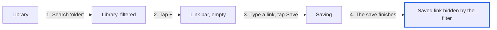
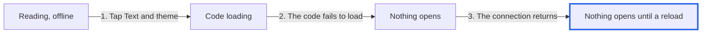
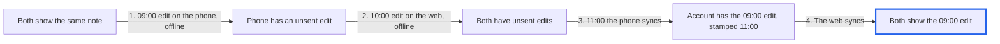

# Arctic for the web: statecharts

Status, 24 October 2026: the specs and charts were written by hand with
pstack's `/statechart` method. **TLC has not run yet**, because Java and TLC
are not installed on this Mac. Each bug below was replayed against the real
code (see [REPLAYS.md](REPLAYS.md)). No app code changed.

The request said "for med". This note models Arctic for the web, the app of
the thread that the request came to. Med, the review app in `apps/med`, is not
modelled here.

## Files

| File | What it holds |
| --- | --- |
| `ArcticWeb.tla`, `.cfg`, `.map.mjs` | The phone shell: library, link bar, search filter, Text and theme sheet, network. Rules 1–3. |
| `PhoneSync.tla`, `.cfg`, `.map.mjs` | One note synced between the phone and the web, and the text of a link saved on the web. Rules 4–6. |
| `arctic-web.mmd`, `phone-sync.mmd` | The states that a reader sees, drawn by hand, with one `%% never` line per rule. |
| `REPLAYS.md` | The temporary tests that replayed each bug, and their output. |

To check the rules and draw the charts from TLC's state graph, copy this
folder to a scratch folder outside the repository, then run:

```sh
node <pstack>/skills/statechart/scripts/statechart.mjs from-spec ArcticWeb.tla --png
node <pstack>/skills/statechart/scripts/statechart.mjs from-spec PhoneSync.tla --png
```

The first run installs TLC and Java with mise (about 305 MB). Ask before you
run it. Each command writes `<Name>-statechart/` with `chart.mmd`,
`stories.md`, `summary.json` and one `bug-<n>.mmd` for each broken rule. Quote
counts only from `summary.json`.

## States

- **Library and link bar:** Library; Library, filtered (a search or a topic);
  Link bar, empty; Link bar, text typed; Link bar, waiting for the clipboard;
  Saving; Reading.
- **Text and theme sheet:** code not loaded, loading, loaded, failed; sheet
  open.
- **Network:** online, offline.
- **One note on a highlight:** both devices show the same note; the phone or
  the web has an unsent edit; both have unsent edits.
- **Text of a link saved on the web:** the account has the link and no text;
  the phone has the link; the phone keeps the text; the web shows the text.

## Rules

| # | Rule | Spec | Result |
| --- | --- | --- | --- |
| 1 | After you cancel the link bar, nothing you did in it gets saved. | `CancelSavesNothing` | Broken: bug 1 |
| 2 | When a save from the link bar is done, its card is in view. | `SavedLinkInView` | Broken: bug 2 |
| 3 | Once things settle while online, the Text and theme sheet you tapped is on screen. | `SheetShowsOnline` | Broken: bug 3 |
| 4 | Once both devices are online and done syncing, they show the same note. | `SameNote` | Holds by reading; TLC to confirm |
| 5 | Once both devices are online and done syncing, the note is its newest edit. | `NewestNote` | Broken: bug 4 |
| 6 | Once the phone has an article's text, the web can show it too. | `TextReachesWeb` | Broken by design today: gap 5 |

Rule 6 is a proposal. The phone does not upload its Reader copies yet, so it
fails today. Agree or drop it with the user.

## Bugs

Paths are relative to `apps/arctic/Browser` unless they start with `apps/` or
`packages/`. A blue border marks the state that breaks a rule.

### 1. Paste saves a link after you cancel (rule 1)

```mermaid
flowchart LR
  A[Library] -->|1. Tap +| B[Link bar, empty]
  B -->|2. Tap Paste| C[Waiting for the clipboard]
  C -->|3. Tap the list to cancel| D[Library, the read goes on]
  D -->|4. The clipboard gives a link| E[Saving]
  E -->|5. The save finishes| F[Saved after Cancel]
  classDef broken stroke:#2563eb,stroke-width:3px
  class F broken
```



- **Code:** the read's result calls `link.submit(text)` with no check that
  the bar is still open (`src/AddLink.tsx:344-347`). Cancel closes the bar but
  does not stop the read (`src/AddLink.tsx:261-265`).
- **Replay:** reproduced. With a clipboard read that takes 1.5 s, a tap on
  the list during the read still saved "Polar night".
- **Reach:** low. The read must wait, for example while Chrome on Android asks
  for clipboard permission. On iPhone, Safari blocks the page while its own
  Paste button shows, so a tap elsewhere refuses the read.
- **Fix direction:** ignore a result from a read that started before the bar
  last closed.

### 2. A link saved during a search is hidden (rule 2)



- **Code:** after a save, `show()` goes to `/` to drop `?q=` and `?topic=`
  (`src/AddLink.tsx:104-106`). The library keeps the query and topic in state
  (`src/Library.tsx:61-62`) and writes them back to the address
  (`src/Library.tsx:72-73`), so the filter stays.
- **Replay:** reproduced. After Save, the toast said "Saved", the address was
  still `/?q=older`, and only "Older reading" showed.
- **Reach:** any save while a search or topic is on: the phone's link bar, the
  wide popover, and ⌘V (`src/AddLink.tsx:91`).
- **Fix direction:** clear the library's query and topic when a save shows
  Saved, not only the address.

### 3. A sheet whose code failed to load never opens (rule 3)



- **Code:** `loading ??= import("./sheet")` keeps a rejected import for the
  life of the page (`src/surface.tsx:73`), and each sheet asks the same
  promise again, with no catch (`src/surface.tsx:94`). The panel's `open`
  stays true, so a second tap changes nothing (`src/Reader.tsx:547-553`). The
  service worker installs only what `index.html` names (`public/sw.js:11-13`),
  so the sheet's chunk is cached only after its first online load.
- **Replay:** reproduced. With the sheet's module blocked, Text and theme
  showed nothing. After the block was removed, Back and a new tap still
  showed nothing. In Chromium, a fresh `import()` of the same URL also failed:
  the browser keeps the failed module too.
- **Reach:** the first sheet after a deploy, offline, before idle preload
  (`src/surface.tsx:80-86`) fetched the new chunk. The Notes and More sheets
  share this code.
- **Fix direction:** precache the sheet's chunk when the service worker
  installs, and on a failure say so and let a later tap try again. The fix
  must handle the browser's cached failure as well. The sheets branch
  (`agent/arctic-sheets-toast`) owns this code.

### 4. An older phone edit replaces a newer web edit (rule 5)



- **Code:** the phone compares `updatedAt` only with the row it pulled
  (`apps/arctic/Sources/LibrarySync.swift:484`). It stamps its upload when it
  syncs, not when the note was edited
  (`apps/arctic/Sync/Sources/ArcticSync/SyncStore.swift:216`). The server keeps
  the higher stamp (`packages/local-sync/src/hono/d1.ts:72-81`). The web stamps
  its edit when it is written (`src/sync/storage.ts:172`), and a later
  record wins the fields that both changed (`src/sync/storage.ts:231-238`).
- **Replay:** reproduced, in a temporary Swift test against the package's
  fake server with the server's rule. Server and web both ended with the
  09:00 note. The web side was a second `SyncStore` stamped at write time, as
  the web's storage does. It was not the web's own client.
- **Reach:** the same note or highlight edited on both devices while one is
  offline, and the device with the older edit syncs first. Reading time
  sessions are not affected, because each visit has its own record.
- **Fix direction:** stamp the phone's change when the note is edited, by
  committing it to the journal then, as the web does. Then the server's rule
  keeps the newer edit.

### 5. Gap: the text the phone keeps never reaches the web (rule 6)

The phone keeps a Reader copy when you open an article, or when it preloads
a visible row (`apps/arctic/Sources/ArticleBrowser.swift:1246`, `:2119`). The
copy stays on the phone (`apps/arctic/Sources/LibrarySyncView.swift:105`). A
link saved on the web keeps "The text of this article is not in your account
yet" until you use Keep a copy (`src/Reader.tsx:237`).

## What the models leave out

- Wide layouts: the popover, the sidebar and keyboard shortcuts. Bug 2
  applies to them, but they are not drawn.
- Toasts and Undo, which `agent/arctic-sheets-toast` is changing. Sync and
  connection status, which `agent/sync-states` is changing.
- The Notes and More sheets, the highlight bar, the toolbar that hides on
  scroll, reading position, and images.
- A clipboard that holds prose, and two Paste taps in a row.
- iOS behaviour: Safari's own Paste button blocks the page.
- Library and article records (the `arctic` namespace), deletions (both sides
  use `deletedAt`, so a deletion syncs as an edit), and reading-time
  sessions.
- Time is in whole minutes, and each minute has one edit. A hybrid clock's
  counter is folded into one number. Each device edits the note once.
- Sign-in, sign-out, account switches and service worker updates.
