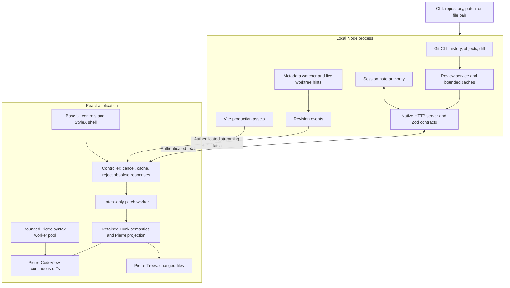

# Med architecture

Med is a local Node host and a compiled React app. The host reads Git, local
files, vaults, and agent transcripts, and serves an authenticated HTTP API. The
browser renders diffs, files, notes, and sessions. Selecting a commit reads Git
objects; it does not change HEAD or check out files.

Related: [file browsing](docs/FILE_BROWSING.md), [agent sessions](docs/SESSIONS.md),
[agent integration](docs/AGENT_INTEGRATION.md), [usage](docs/USAGE.md), and
[testing](docs/TESTING.md).

## Layout

```text
┌ Threads ──────────┬ Changes ──────┬ Review ─────────────────────────────┐
│ New thread     ⌥N │ Path filter   │ Title · branch · range              │
│ workbench         │ Tree and      │ Changes · Commit · file tabs        │
│   Task A  +12 −3  │ counts        │ File A header                       │
│   Task B  ◌       │               │ Hunks · source selection · notes    │
│ blog              │               │ File B …         One scroll surface │
│   Task C          │               ├ Session ────────────────────────────┤
│                   │               │ Prompts, replies, tool calls        │
│ Repositories   10 │               │ Message box                         │
├───────────────────┴───────────────┴─────────────────────────────────────┤
│ Connection · file totals · request / parse / first-frame timing         │
└─────────────────────────────────────────────────────────────────────────┘
```

The sidebar lists the tabs: the threads that the user has open, by repository
in the user's order, with each lead session's state and its Claude subagents.
The other threads are history ([threads](#threads)). The workspace beside it is a tree of
panes ([panes](#panes)): the review, and Changes, Session, Files, and Preview
around it.

All changed paths stay in the tree. Selecting a path shows it in the one
continuous diff stream. Binary files, oversized files, and entries without a
text patch get metadata rows; Med does not invent empty patches. Pierre's
virtualizer mounts only nearby rows.

Branch tabs map local refs to the worktrees that Git reports. An attached
branch opens its working changes; a branch without a worktree opens its
committed snapshot, without working-copy controls. A stale worktree mapping
falls back to the snapshot. No tab action runs checkout or switch.

The read-only file browser has a right sidebar and center tabs beside a
permanent Changes tab. Attached worktrees give current files; other branches
give an exact commit tree.

## Boundaries and dependencies



| Responsibility                               | Implementation                                                                         |
| -------------------------------------------- | -------------------------------------------------------------------------------------- |
| Diff rendering, line virtualization, context | `@pierre/diffs` 1.4.3, patched at build time; one CodeView, no second virtualizer      |
| File trees                                   | `@pierre/trees`                                                                        |
| Syntax tokens                                | Twinkleplop and Med's own grammars ([syntax highlighting](#syntax-highlighting))       |
| Editing                                      | CodeMirror 6 and `@replit/codemirror-vim`, loaded on demand                            |
| Selectors, menus, dialogs, tooltips          | `@base-ui/react`                                                                       |
| Layout, themes, focus, density               | StyleX and a small CSS reset                                                           |
| Markdown                                     | unified, remark, and rehype in a worker; KaTeX and Mermaid on demand                   |
| Separators and status elements               | Local React, HTML, and SVG                                                             |
| Browser state                                | Local controllers and React external-store subscriptions                               |
| Review semantics                             | Pinned Hunk source ([Hunk provenance](#hunk-provenance))                               |
| Runtime schemas                              | Zod                                                                                    |
| Git and processes                            | Node subprocess API and the installed Git CLI                                          |
| Watch hints                                  | Native recursive watch on macOS and Windows; bounded Chokidar fallback, reconciliation |
| HTTP and SSE                                 | Native Node HTTP and browser fetch                                                     |

Med needs no Hono, Express, query framework, router, generic state store,
splitter or pane library, daemon broker, or desktop framework. The installed app serves
its compiled assets. It never loads the reviewed repository's Vite config or
runs its scripts. [Dependencies](../../docs/DEPENDENCIES.md) says when to build
our own code and when to take a dependency.

Vite 8 supplies Rolldown and Oxc. The React plugin uses Oxc; the StyleX plugin
still uses Babel at build time. Oxlint runs StyleX's validation plugin, and an
integration test confirms that an invalid StyleX declaration fails. Oxfmt
formats; TypeScript and Vitest check. The lockfile pins all versions.

## Syntax highlighting

Twinkleplop gives tokens to the worker and main-thread paths. Med has its own
grammars for Java, C++, XML, JSON, JSONC, Go, Rust, and Swift in
`src/web/highlighting/languages/`. The Go, Rust, and Swift scanners give the
scope stacks of the TextMate grammars that Shiki uses;
[upstream/GRAMMARS.md](upstream/GRAMMARS.md) records their sources and licenses.
`languages.ts` loads each grammar on demand and adds the root scope, such as
`source.json`, to scanners that give scope stacks. `scopeOverrides` maps
Twinkleplop's CSS token kinds to the scopes that Shiki uses. The adapter
(`src/web/highlighting/adapter.ts`) reads each token's scope stack, changes
UTF-16 ranges to Pierre's HAST, and adds word-change decorations and theme
colors. It resolves theme rules as vscode-textmate does, with parent and child
(`>`) selectors and their specificity. Twinkleplop grammars give one scope per
token kind, so parent selectors seldom match them. Markdown fences load their
embedded grammars. Unsupported languages use plain text.
`bun run test:highlighting` compares Med's grammars with Shiki through Pierre.
Go, Rust, and Swift use Shiki's Oniguruma engine as the reference, because its
JavaScript engine misreads some Swift comments and fails on some Go files.

`tools/pierre-highlighter.ts` patches Pierre 1.4.3 at build time and rejects
another version or a missing source boundary. Pierre keeps the worker queue,
cache, diff layout, and line transforms. Full-file workers tokenize the whole
source and send styled text runs with a shared style table. The pool builds a
line's HAST only when the renderer asks for it, and rejects obsolete results
before it decodes them. Diff results keep Pierre's wire format.

The normal build has no Shiki tokenizer or grammar modules. Theme data, theme
normalization, and Pierre's token transform stay as transitive Shiki
dependencies. The build fails when emitted chunks contain a Shiki engine or
grammar module. A Pierre upgrade needs a new integration audit.
`MED_HIGHLIGHTER=shiki bun run build:web` builds the comparison baseline with
Pierre's original engine. See
[the integration and video comparison](docs/validation/HIGHLIGHTER_INTEGRATION.md).

A file read resolves the language during I/O and starts bounded highlighting
when the response arrives, before React mounts the view. The viewer joins that
task through Pierre's cache key.

## Requests, identity, and invalidation

```mermaid
sequenceDiagram
  participant U as User
  participant C as Browser controller
  participant H as Local host
  participant G as Git
  participant W as Patch worker
  participant V as Pierre stream
  U->>C: Select comparison
  C->>C: Cancel old fetch and parse; check bounded cache
  C->>H: Review request with comparison
  H->>G: Resolve objects and obtain bounded patch / metadata
  H-->>C: Review ID, resolved endpoints, files, patch, timing
  C->>W: Parse patch
  W-->>C: Parsed file metadata
  C->>C: Reject result if selection changed
  C->>V: Project all files; render visible rows
  V->>H: Request full source for context expansion
  H-->>V: Matching immutable bytes, or stale error
  G-->>H: Worktree or metadata watch hint
  H-->>C: Revision event
  C->>C: Refresh affected mutable view
```

The first request sends one bounded patch and all file metadata. A latest-only
worker parses it; a new parse stops obsolete work. Full source reads occur on
demand, for context expansion.

Full object IDs permit immutable caching. Symbolic revisions, patches, file
pairs, and working changes are read again. Fetches and note loads carry request
generations, so a late response cannot replace a newer comparison. Note
changes carry an expected revision, and the server rejects outdated changes.

Notes survive refreshes. Notes on changed files become stale; notes on missing
files become orphaned and stay accessible. Med does not move notes to new line
numbers. Branch review notes live in host memory; saved reviews use a
persistent store.

Immutable context comes from resolved Git objects. Mutable context checks its
captured file and index signature before Med returns it. File pairs use frozen
byte snapshots; standalone patches do not claim full-source authority. A stale
source request fails; it does not mix current contents with an old patch.

Watch events are hints, not content. Commit comparisons watch Git metadata
only; working views watch the worktree. Med coalesces events, and periodic status
reconciliation finds missed changes. A reconnect refreshes, also when a
revision repeats. A refresh can replace the whole patch.

Review and source caches have byte and entry limits (`src/shared/byte-lru.ts`).
Pierre gets a separate render copy, because context hydration changes metadata.
Cache limits are not a process memory limit. Host requests, event streams, file
inputs, note text, and note count have limits too.

## Repositories and workspaces

A repository family is identified by its canonical Git common directory.
Linked worktrees share its opaque registry ID; separate clones have separate
IDs. Tab identities combine the repository ID with a branch name or a detached
worktree path. File sources keep their exact repository path and, for
committed content, the object ID.

The host validates registered paths before reads and routes search to the
owning repository. Discovery replaces worktree membership, so a removed path
loses access. Removing a registration revokes its sources and review IDs and
releases its watchers and search service. Registration never changes files or
branches.

A workspace is a task: a branch or detached worktree, a saved review, or a
vault. `data/workspaces.ts` keeps identities and display text in `localStorage`
(`med:workspaces:v1`, at most 24), and windows share the list through `storage`
events. Each window keeps its own active workspace. The first branch workspace
is the home and cannot close. A branch change in a workspace cancels old
requests, restores that branch's navigation, and reloads mutable content.

`WorkspaceHost` (`components/Workspaces.tsx`) owns the store, the address,
the thread sidebar, `⌘1`–`⌘9` (the tabs in sidebar order), `⌘0`, `⌘⌥W`, `⌘⌥T`,
and the `⌃Tab` switcher, which also searches history. Each workspace has its
own review controller and `App`. The tabs stay mounted in React `<Activity>`,
shown in this window or not, as a terminal keeps its open tabs: one leaves
memory when it closes. Beyond 16 tabs (`TABS_MOUNTED`), the ones shown least
recently leave memory and stay in the sidebar. History never mounts until it
opens. Of the other workspaces, such as branches, the six most recently shown
stay mounted; older ones are disposed and load again when shown. A thread
takes about 5 MB of JavaScript heap and 15 MB of renderer memory; one with a
12,000-line diff about 14 MB of heap. Activity runs effect cleanups when it
hides a workspace, so objects that live as long as the workspace register with
`useDisposeOnClose`. `tools/pierre-keep-alive.ts` and `StableFileTree` keep
Pierre's views and trees while a workspace is hidden. When the browser is idle,
the pool mounts the next workspace in advance, one at a time, also beneath
the Sources page, so the first `⌘1`–`⌘9` after a reload shows a loaded thread.
`⌘1`–`⌘9` read the thread's saved review and session at the key, before its
workspace mounts, as a pointer that rests on a row does.

A pointer that rests on a thread row for 60 ms reads the thread's saved review,
its diff, and its checkout's session (`prefetchSavedReview` in
`data/controller.ts`). The controller takes that read when the thread opens, if
it is less than 10 seconds old, and does not read the saved review again within
2 seconds. A saved review opens with the checkout's session, not
`GET /api/repositories`: the session reads that repository again from Git and
lists the others as the host knows them, and the diff reads at the same time.
The saved diff needs no Git, so it shows when it arrives; the session then
adds the Git parts, such as the Commit tab, in one update. When the Session
pane is open, the session leads: the workspace shows when its thread is ready,
and the saved diff and the Git update wait for the controller's `lead` option
until the thread has painted (at most 600 ms). The page has one main thread,
and a large diff takes it for tens of milliseconds. The diff view's key
names the saved target, not the checkout, so that update does not mount it
again. Each Git process costs about 10 ms on macOS, so the open waits on as few
dependent reads as it can. The host lists repositories in parallel and shares
one listing among concurrent callers.

Only the workspace on screen keeps its live-update stream; `resume()`
reconciles without clearing the screen. Every event stream of a page is a
channel of one live stream (`data/live.ts`): a WebSocket at `/api/live`, or an
event stream where a WebSocket cannot open. A WebSocket does not count toward
the browser's six connections to one host, so windows and tabs do not starve
each other's requests. Agents announce new reviews on `GET /api/windows`. One
window holds that stream under a Web Lock and passes reviews to the other
windows on a `BroadcastChannel`.

The address follows the active workspace: `/review/<id>`, `/vault/<id>`, or `/`
with the workspace ID in `history.state`. Back and Forward move between
workspaces.

`/search?q=…` is the search page (`components/SearchPage.tsx`). The host draws
it over the workspaces and keeps the active one; while it shows, the keys are
the page's. Its `history.state` names the workspace that opened it and that
workspace's checkout, so a match in that repository opens there, and a match in
another repository opens in that repository's workspace. The file opens when
the workspace reads its files (`data/file-opens.ts`), at the commit that the
search read. Each repository's search is its own `X-Med-Latest` stream, so the
searches of one query do not cancel each other, and four run at once.

### Threads

A thread is a saved review, or a session that Med found
([found sessions](docs/SESSIONS.md#found-sessions)). The threads that the user
has open are tabs; the others are history. `src/host/thread-tabs.ts` keeps
which threads are tabs, their order, and when each closed, in `tabs.json` in
the state directory. `src/host/thread-service.ts` builds the lists:

- `GET /api/threads/events` sends the tabs, in order, with the registered
  repositories, and sends them again when they change; the host checks every
  1.5 seconds, and at once when a tab opens, closes, or moves. A tab's state
  comes from its lead session (`src/host/agent-status.ts`), its Git work from
  `checkout-work.ts`, and its Claude subagents from `thread-subagents.ts`
  (`<session>/subagents/agent-<id>.jsonl` and its `.meta.json`, which names
  the task and the tool call that started it).
- `GET /api/threads/history` lists the closed threads, the found sessions that
  are not tabs, and the records of pruned threads, newest first. The host reads
  no agent state for history; it reads each first prompt once, for search.
- `POST /api/threads/:id/open` (with `restore` for its old place),
  `/close` (with `removeWorktree`), `/delete`, `POST /api/threads/reopen`, and
  `POST /api/threads/order` change the tabs. `med thread` uses the same routes.
  `/archive`, from before tabs, closes or opens.

A new thread, a hand-off, an adopted session, and Keep in Med open as tabs. A
found session opens as a tab once, when Med first sees it work. The browser
closes a tab on its own when its work has landed (`landed` in
`web/data/tabs.ts`), from the window used last, never when `unlanded` is
unknown.

The signals for tabs that need the reader are in `web/data/signals.ts`. Each
window sets the installed app's badge to the same count, from the same list.
A window holds the shared Web Lock `med:looking` while it is visible or
focused. The window that holds the lock `med:notifier` sends the opt-in
notifications, and only when no window holds `med:looking`.

The first start with tabs makes them from the saved reviews: an archived
review closes at `archivedAt`; of the others, the 8 newest that changed in the
last 7 days (`FOUND_DAYS`) open, newest first; the others close. At start and once a day, the host prunes
history: 30 days after the close it replaces the saved review with a short
record (title, repository, branch, sessions), which opens as its newest
session's found thread; after 180 days it deletes the record. The captures
that go are the thread's Review versions; a thread without a Review keeps its
`checkout` in the short record. Over the 512 MiB storage budget, the reviews
that closed first give up their captures first.

`POST /api/threads` starts a thread. With a worktree, the default, the host
names a branch for the task (with `-2`, `-3`, … when the name is taken), adds a
linked worktree for it in the state directory
(`worktrees/<repository>-<id>/<branch>`), saves the review on its working
changes, and starts the agent there on the task. `POST /api/threads/:id/close`
with `removeWorktree` also runs `git worktree remove` without force, so Git
keeps a worktree with changes and the host returns 409; it refuses a worktree
that another tab uses. The branch stays.

**Attempts.** A start with `group: { id, attempt }` is one attempt at a task
that several agents do. It needs a worktree; its branch is the task's name
with the attempt's letter (`-a`, `-b`, `-c`). The saved review keeps the group,
and the thread list carries it, so the sidebar shows the group as one row.
`src/host/attempts.ts` serves `/api/attempts`: the compare reads each open
attempt's diff against the attempts' common ancestor (`git merge-base
--octopus`), with untracked files, and each lead session's agent, model, time,
checks (test, lint, type-check, and build commands in its tool calls), and
last message, cached by transcript size and time. Keep stops the other
attempts' agents, saves their changes as a commit on their branches (no hooks,
no signing), removes their worktrees without force, and closes them. Undo,
kept in host memory, adds each worktree back from its branch and resets the
saved commit, so the work is uncommitted again.

### Panes

`data/pane-tree.ts` holds the layout as pure functions over a tree: a leaf is
a pane ID, and a split has an axis, children, and sizes. They insert, remove,
move, swap, resize, balance, and lay out panes. A pane has a minimum of
220 × 120 pixels: `fitted` raises a child below its minimum and takes the room
from its siblings in proportion, and `fit` leaves out panes in tree order,
except the focused and fixed ones, until the rest fit.

`components/PaneTree.tsx` places each pane at its rectangle with absolute
positions, so a new layout moves panes and does not mount them again. Focus
and the entering pane live in a small external store, so a focus change does
not render `App` again. A drag of a pane's grip shows the drop zone on the
pane under the pointer: a side places the pane there, and the middle swaps the
two. Each workspace saves its tree and zoom in `localStorage`
(`med:panes:v1:<key>`).

A theme is a whole look (`Aesthetic` in `themes.ts`): fonts, corners,
hairlines, selection, buttons, label case, and shadows, as `--med-*` variables.
Code stays in Paper Mono. Fonts and icons ship with Med. See
[theme sources](upstream/THEMES.md).

## Git behavior and limits

Med runs the Git CLI with argument arrays and an explicit repository
directory. It disables external diff helpers, textconv, and repository
fsmonitor hooks. It limits subprocess output while it reads, cancels obsolete
processes, and enforces timeouts. It discovers worktrees with Git; it does not
assume that `.git` is a directory.

| Mode      | Before                     | After                                   |
| --------- | -------------------------- | --------------------------------------- |
| Working   | HEAD or empty tree         | Worktree, including untracked additions |
| Staged    | HEAD or empty tree         | Index                                   |
| Unstaged  | Index                      | Worktree, including untracked additions |
| Commit    | First parent or empty tree | Selected commit                         |
| Range     | Resolved base              | Resolved head                           |
| File pair | Explicit old file snapshot | Explicit new file snapshot              |
| Patch     | Patch-provided before side | Patch-provided after side               |

A range compares its two endpoints. `mergeBase: true` first resolves one common
ancestor; no merge base or more than one gives a clear error. Saved reviews
freeze the resolved endpoints. A worktree selection reads another working
directory and index, with shared Git objects; it does not run `git switch`.

**Push.** The Push dialog publishes one exact commit to a named branch of a
configured remote. The host validates refs, keeps push hooks, and disables
force, mirror, tag following, and recursive submodule pushes. It rejects
remotes with more than one push URL and does not show remote diagnostics,
because they can contain credentials. No browsing or comparison action pushes.

**Commit.** The Commit tab (`src/host/repository/commit-flow.ts`) is the only
part of Med that changes the index or makes commits. Stage and unstage take
whole files, and each path is literal (`GIT_LITERAL_PATHSPECS`). A commit sends
its message on standard input with the index key that the view showed: a hash
of HEAD and of each index entry that differs from HEAD. If the index or HEAD
changed, the host returns 409 and commits nothing. Hooks run as in a terminal,
without an editor or a credential prompt; when a hook stops the commit, the 422
response has the last 8,000 characters of its output. Push from the Commit tab
uses the same exact-commit push, to the branch's upstream; a branch without an
upstream pushes only after the user agrees. There is no force push, amend, hunk
staging, or branch switch.

## Saved reviews and agent sessions

The CLI uses a stable default port (6330) and a private state directory
(`~/.local/state/med`). A persistent credential and a connection record for
each port let `review repos` and `review create` find the running host. Without
`--port`, a client command uses the default port, or else the one live host on
another port (a service that kept the old default, 4173). The
browser exchanges the launch token for a same-origin HttpOnly cookie, then
removes the token from the URL. Saved links contain only a review ID and cannot
register repositories.

`src/shared/saved-review.ts` defines a review bundle with one or more
repository and comparison targets. Before it writes a bundle, the host resolves
commit references and captures the patch and the supported source bytes.
Comments are kept for each target; feedback export and clear apply to the whole
bundle. Revision checks stop a stale clear from deleting newer comments. Atomic
private files and a cross-process write lock protect the records. Saved source
does not follow watcher events.

A thread's bundle is its **Review**: the versions (the bundle's iterations)
that the agent hands off with `med thread show`, `med review create --key`, or
`POST /api/reviews/:id/versions`. A thread that New thread, Keep in Med, or
`med thread adopt` makes saves only its checkout (`checkout`: repository,
path, branch) and no target. Its **Changes** are a live comparison of that
checkout, which Med never saves: a `working` comparison with `base`, from the
merge base of the base branch and HEAD to the working files, on a branch
other than the base, and plain working changes on the base. A Git comparison
can keep only `paths` (literal pathspecs; an empty list keeps no file), or the
files that a Claude Code or Codex `session` edited: `/api/review` reads them
from the transcript (`src/host/session-edits.ts`) and asks Git for those
paths. A saved target keeps paths, never a session. The thread list
(`src/host/thread-service.ts`) counts a tab's Changes until its first
hand-off (`src/host/checkout-changes.ts`, read in the background every 30
seconds, and at most every 4 seconds while a session changes), and marks a
checkout that is shared: the repository's main checkout, or one with two or
more tabs' sessions. A bundle made before Changes were live keeps its
first capture as version 1; the browser treats an empty capture alone, with
no brief or guide, as no Review (`hasReview` in `src/web/data/controller.ts`).

In the browser, the controller's `inReview` says whether the diff is the
Review's (a version, or a commit of its range) or the live Changes. The pane's
tabs map to it: **Review** is the Guide or the `changes` view in Review, and
**Changes** is the `changes` view outside it. The controller keeps the last
live comparison that the reader chose, so Changes come back as they were.

A bundle can hold a Markdown brief and pinned notes. `src/web/data/brief.ts`
resolves each link to a changed file and line range (exact path, then a unique
path suffix) and shows the cited range as an excerpt. A bundle with a pull
request URL can show GitHub comments: `GET /api/reviews/:id/pull-request` runs
`gh api` with GET requests only and keeps the result for 30 seconds. Med never
writes to GitHub.

A bundle and each version can hold a guide (`src/shared/review-guide.ts`): a
summary and segments, each with file patterns and the agent's comments on
lines. The host checks it with the shared schema on create and on
`POST /api/reviews/:id/guide`. For a commit range, a capture also records up to
50 commits of `base..head`. `src/shared/guide-paths.ts` matches a segment's
paths, folders, and globs to changed files. The CLI uses it after create and
update to print the files that the guide leaves out or names twice, after
pulls.review's coverage check; `src/web/data/guide.ts` uses it to place each
segment and comment, and files that no segment names form a last automatic
segment. The Guide, in the Review tab, reuses the
diff stream with only the segment's files, so it keeps virtualization,
annotations, and notes. Viewed marks (`src/web/data/viewed.ts`) are kept in
`localStorage` for each review, keyed by path and new blob ID, so a changed
file shows as unviewed again.

A bundle records the agent sessions that worked on it. The host converts a
session's Claude Code transcript or Codex rollout to Agent Client Protocol
`session/update` shapes and streams them (`src/host/agent-transcripts.ts`); see
[agent sessions](docs/SESSIONS.md). The CLI contract and data limits are in
[agent integration](docs/AGENT_INTEGRATION.md).

## Editing and file writes

Eligible worktree and local files open in CodeMirror in Vim Normal mode.
Commit snapshots, dropped files, and files above the edit limit use Pierre.
Opening a file never writes it. Drafts and undo history live in a bounded
store for each `App`, in memory only; a reload loses them, and closing a dirty
editor needs an explicit discard. A disposable worker gives syntax
decorations; a generation number stops an older result from coloring newer
text.

`POST /api/browse/write` uses the host, origin, session, and repository checks.
It accepts a worktree source, a relative path, the expected content identity,
and up to 1 MiB of UTF-8 text. Saves to one file run one at a time. The host
validates the path and content, writes and flushes a sibling temporary file,
checks the current content, file metadata, and repository access again, then
atomically replaces the target. A detected change returns 409 and keeps the
draft. Another process can still write after the last check. There is no
forced overwrite or automatic merge. Hard-linked and symlinked files are
refused. A save does not stage or commit.

Standalone files have their own source kind. Each grant is one exact canonical
path, at most 256 for each host, and Med does not register or index the parent
folder. Dropped files stay in the browser and never reach the host.

Full-file gutter markers carry a content identity. The host uses captured
sources only when the displayed bytes match; otherwise a working file compares
with HEAD. Git makes zero-context hunks in a disposable directory and changes
no checkout file. Blame reads 1,000-line chunks, keeps 32, and shares one
`git blame` process for each chunk.

## Markdown preview

The preview worker runs remark-parse, remark-gfm, remark-math, remark-rehype,
and rehype-stringify. It keeps top-level source ranges for scroll mapping and
heading IDs for navigation. **Raw HTML is disabled and link schemes are
limited.** KaTeX loads only for math, with trust disabled and expansion
limits. Mermaid loads on demand, renders near the viewport, and uses strict
security. Code fences use the Twinkleplop adapter.

Image requests accept only supported image types up to 8 MiB, with exact
document grants or registered repository access. Standalone images stay in the
document folder, repository images in the repository, and commit images come
from the same Git tree. Symlinked paths and traversal are refused. Image
responses have a restrictive CSP and no-sniff and no-store headers.

Relative links resolve from the document path, not the browser route, and
cannot leave their source root. Vault links stay in the vault. No Obsidian
plugins run.

## Media

File reads classify media by extension after the source and path checks.
Responses contain the MIME type, size, and version, never encoded media.
`/api/media` serves authenticated GET and HEAD requests with single byte
ranges. Worktree and local sources open no-follow handles and seek; commit
sources stream `git cat-file` with backpressure. Streams use 64 KiB chunks,
stop on disconnect, and check repository access for each chunk. Images are
limited to 32 MiB and videos to 4 GiB. Rendered SVGs never enter the DOM as
markup. Saved reviews store bounded image snapshots.

## Service and vaults

`ServiceManager` owns `SourceCatalogue`, registered repositories, vault
watchers, and the vault index queue. A private exclusive lock stops two managed
servers from owning one state directory. `med web` starts a detached server
only when needed; `med serve` runs the same owner in the foreground. Login
service installation is a separate, explicit operation.

`GET /api/build` reports whether the code on disk differs from the running
code. `POST /api/service/restart` first runs `--version` from disk, so a broken
build never replaces a working server; under its LaunchAgent, the server asks
launchd to restart it.

A vault is identified by its canonical folder. Watch events wait 150 ms, with
reconciliation every 60 seconds. One short-lived subprocess parses and writes
SQLite (`bun:sqlite` or `node:sqlite`); no indexing runs in HTTP handlers.
Read-only WAL connections serve backlinks during an update, and the last good
index stays readable. Enumeration skips hidden and dependency folders and
symlinks; reads do not follow links. Private content never enters Git.

First-run discovery (`setup`, `discover`, `login`) searches the home folder to
depth 4, at most 40,000 folders and six seconds. It reads folder names and Git
metadata only and does not follow links. `login` writes or removes the
LaunchAgent plist only.

The standalone build embeds the browser assets and offline guides in one
Bun-compiled executable. Git, Ctags, and Zoekt stay external.

## Hunk provenance

The review semantics come from Hunk
[`9b95a71b76c472bad21ffa5cc6b01b204e2f6f7a`](https://github.com/modem-dev/hunk/tree/9b95a71b76c472bad21ffa5cc6b01b204e2f6f7a).
[Provenance](upstream/HUNK.md) records the retained modules and changes, and
the MIT notice stays. Med keeps review actions, anchors, document projection,
geometry, identities, navigation, note limits, reducers, selectors, state,
validation, and their behavior tests. Local adapters connect them to Pierre and
the HTTP controller.

Med does not keep Hunk's daemon transport or publication protocol, and does not
claim compatibility with Hunk agents, extensions, or producer protocols. The
host owns source snapshots and notes; selection, filters, scroll, and
presentation stay in the browser. JJ, Sapling, terminal modes, extensions,
merge editing, and branch changes other than the Commit tab are out of scope.

## Review order

1. `src/shared/protocol.ts`: the wire contract and comparison variants.
2. `src/host/repository/` and `src/host/server.ts`: Git semantics, source
   lifetime, authentication, and limits.
3. `src/web/data/`: response guards, cache policy, projection, and note sync.
4. `src/web/App.tsx`, `components/`, and `theme.stylex.ts`: layout and controls.
5. `tests/` and `scripts/`: behavior and reproducible measurements.

Measurements: [file browsing](docs/validation/FILE_BROWSING.md),
[interactions](docs/validation/INTERACTIONS.md),
[file opening](docs/validation/FILE_OPENING_SECOND_PASS.md),
[highlighting](docs/validation/HIGHLIGHTER_INTEGRATION.md),
[vault index](docs/validation/VAULT_INDEX.md), and
[media](docs/validation/MEDIA.md).
