# Using Med

Med is a review app that runs on your Mac. A coding agent hands off its work,
you read the diff and comment on lines, and the agent answers and goes on. Med
shows the agent's session beside its changes, in your browser, from a server
on `127.0.0.1:6330`. Your code, reviews, and comments stay on your Mac.

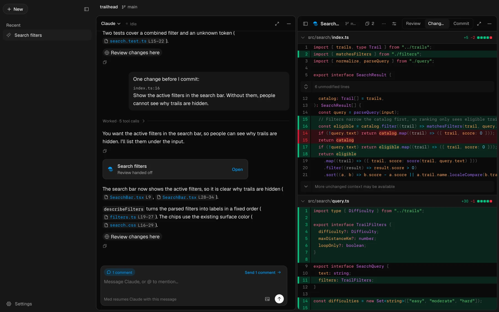

## The words

- A **source** is a repository, or a vault of Markdown notes, that you added
  with `med add`. Med watches it for changes.
- A **thread** is one task: an agent's session and the changes it hands off.
  Your open threads are the rows in the sidebar.
- A **session** is one agent conversation. Med either runs it, or reads one
  that another app runs.
- A **hand-off** is what an agent shows you with `med review create`: a diff,
  or part of one. The agent picks what it compares, such as the whole change
  or only the latest round. A later hand-off with the same **key**, usually
  the branch, joins the same thread and opens on **New since you looked**.
- A **review** is the saved record of a thread's hand-offs: the captured
  diffs, the guide, and the comments. It is a view on a set of changes, kept
  so it still reads the same after the branch moves on.
- A **guide** is optional: the agent's summary, then parts that you read one
  at a time. A diff with a sentence is enough.
- A **comment** is your note on lines. It is a draft until you send it, and
  the agent answers it in its thread with `med reply <id>`.

## A review, round by round

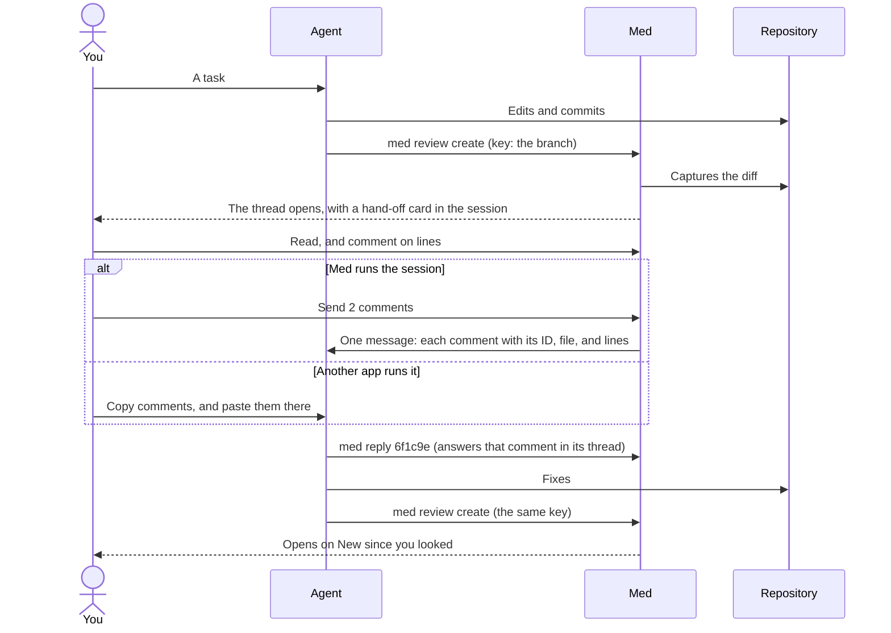

The review has three pages, `1`–`3`:

- **Review**: the agent's guide, if it gave one, and its summary.
- **Changes**: the diff, with your comments and the agent's answers.
- **Commit**: stage, commit, and push working changes.

| Review                                                                      | Changes, with the agent's answer                                         |
| --------------------------------------------------------------------------- | ------------------------------------------------------------------------ |
| 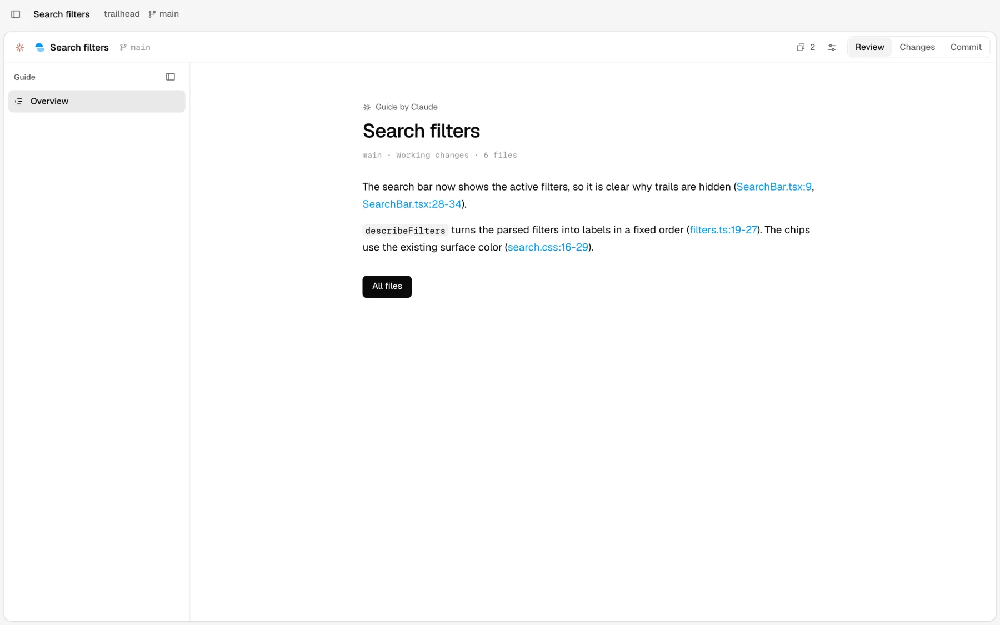 | 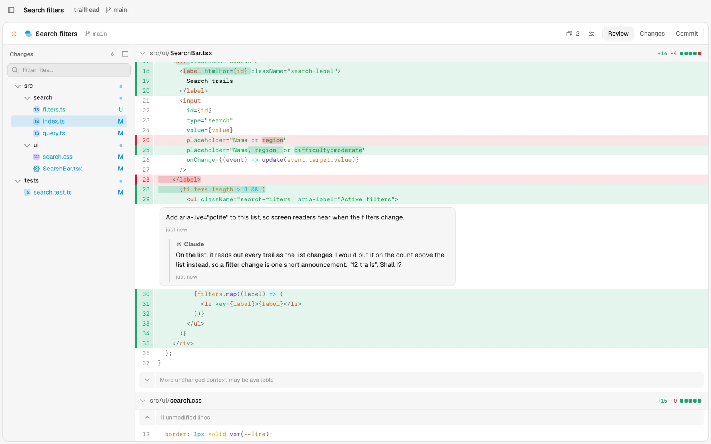 |

| Commit                                                                 | Settings                                               |
| ---------------------------------------------------------------------- | ------------------------------------------------------ |
| 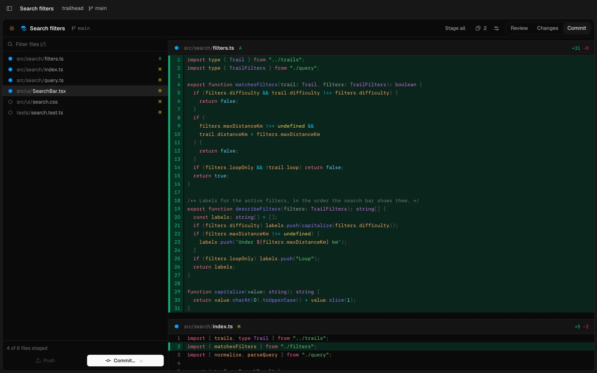 | 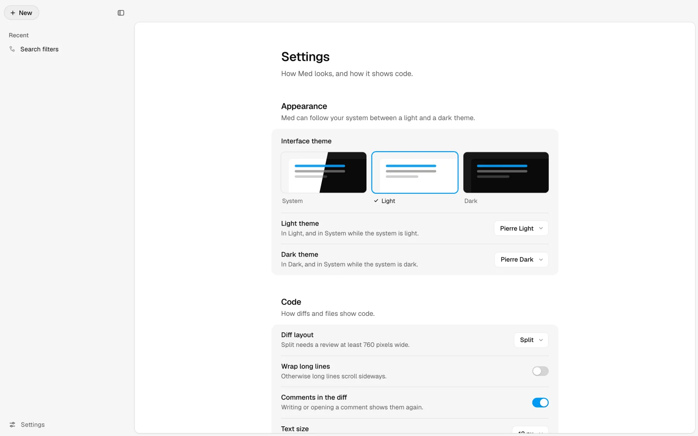 |

| Display, a row for each choice                                                     | Settings › Open in                                                                    |
| ---------------------------------------------------------------------------------- | ------------------------------------------------------------------------------------- |
| 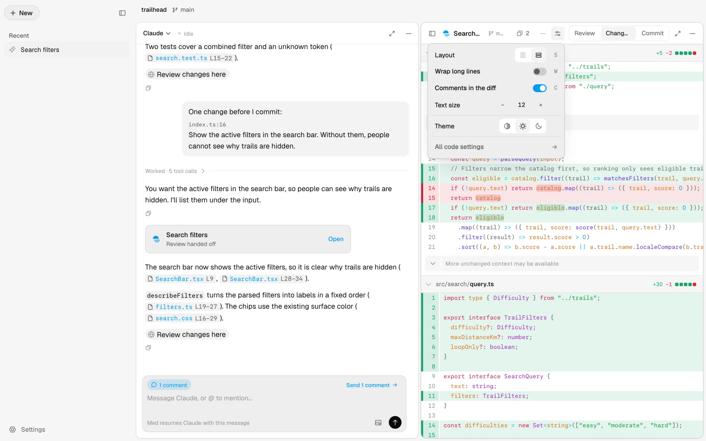 | 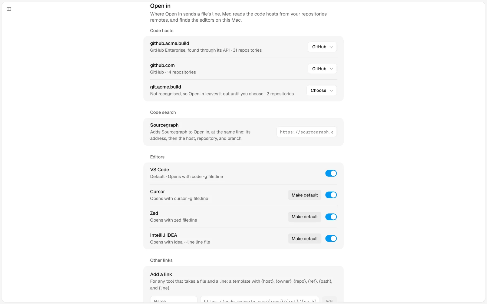 |

The review's header keeps one action, **Copy comments**, with their number;
the rest is in `⌘K`, Settings and each of its sections too. Every pane's
header has **Expand** (`⌘E`) and **Hide** (a line). The review hides while the
session shows beside it; the session's header then has **Show review**.

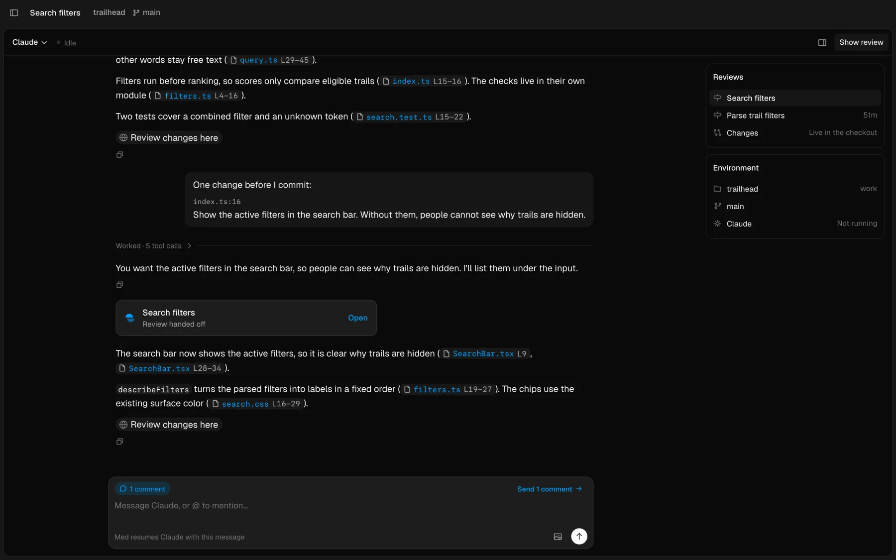

## Where a message goes

Med writes only to a session that it runs, because one session can have only
one writer.

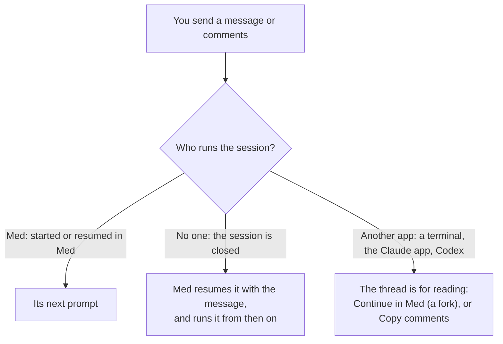

## Under the hood

### What runs where

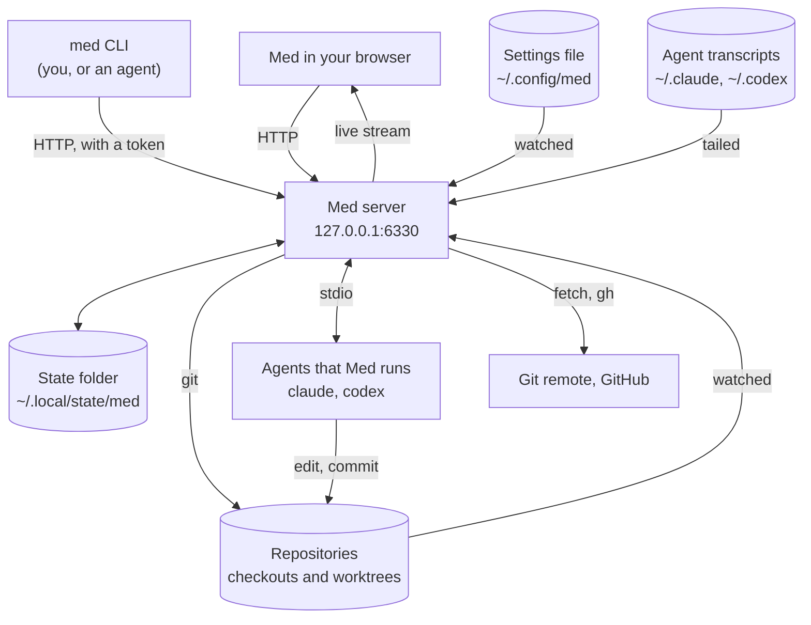

- The **state folder** holds the saved reviews (`reviews/`), the open tabs
  (`tabs.json`), the sessions Med runs, and the token that the CLI uses to
  reach the server. A second profile is another folder: `--state-dir`.
- A **review** is captured when the agent hands off: Med copies the diff and
  the files' text, so the review reads the same later.
- The browser reads with plain HTTP calls, and one **live stream** per page
  brings every change: a repository's files, a session's updates, a setting.

### A session's updates

Every source of a session becomes the same updates, those of the
[Agent Client Protocol](https://agentclientprotocol.com) (ACP). The thread
only knows that model ([agent sessions](SESSIONS.md)).

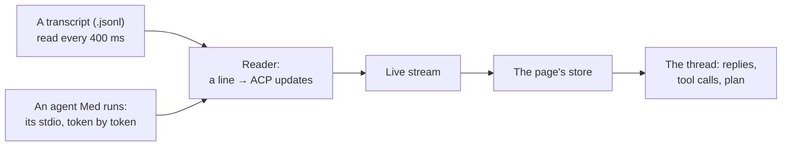

### Settings

Every setting is a key in `~/.config/med/settings.json`
([settings](usage/settings.md)). A choice in Med writes its key; an agent or
an editor can write the file, and Med applies the save at once.

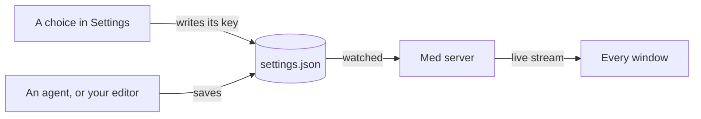

### Base branches stay up to date

A minute after Med starts, then every 15 minutes, Med fetches each
repository's base branch and moves it forward as `git pull --ff-only` would.
It never merges, rebases, or asks for a password. Turn it off with
**Settings › Sources › Pull base branches** (`sources.pullBase`).

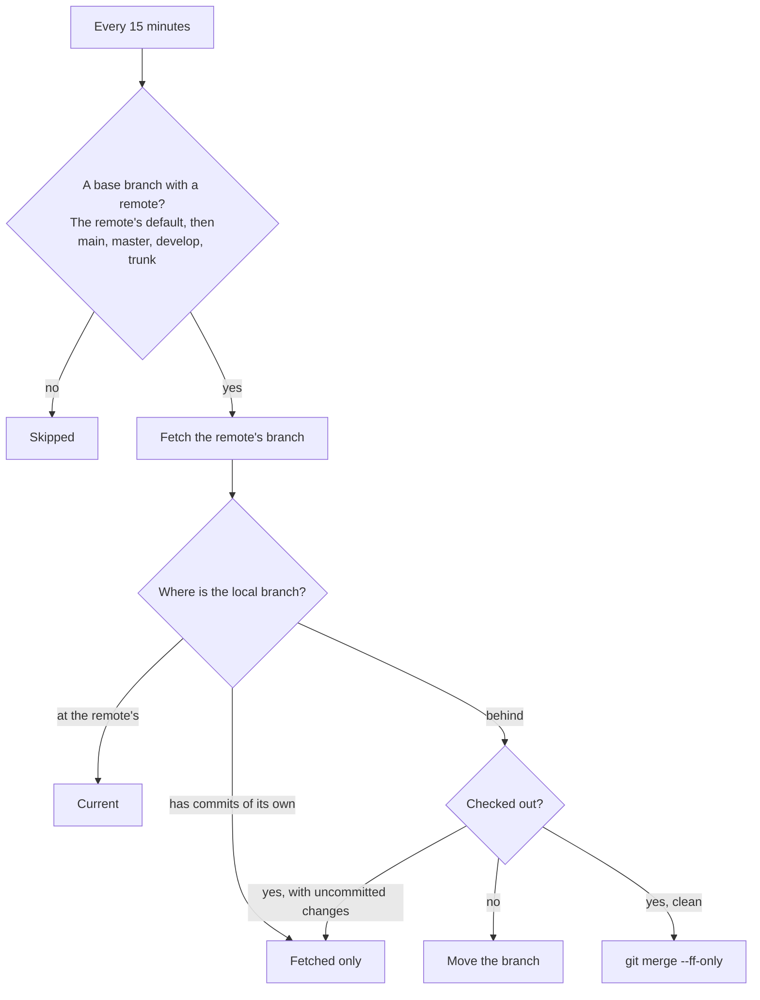

## Prototypes

The Screens page (`/screens`, in a development build) shows designs on
made-up data before they reach the app. The find bar started there: one bar
for `⌘F` in a diff, `⌘F` in a file, and Vim's `/` and `?`, now in both.

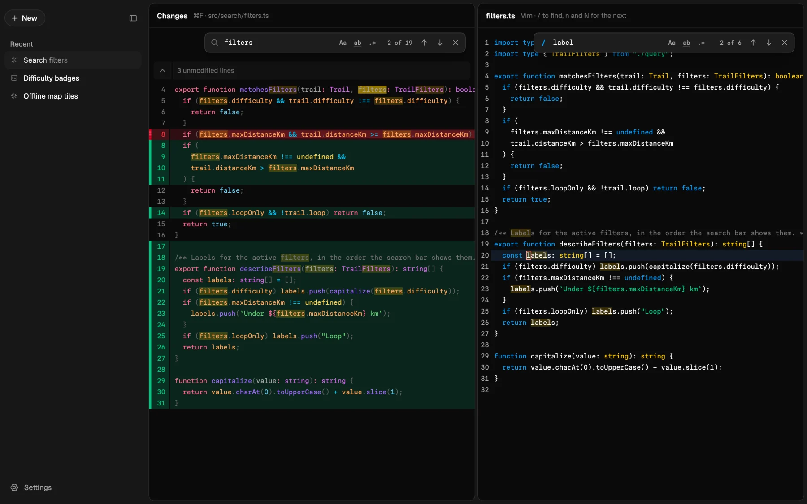

## Pages

- [Run Med](usage/run-med.md): start the server, start it at login, and add sources.
- [Threads](usage/threads.md): the sidebar, New thread, an agent's session, and scheduled tasks.
- [Review changes](usage/review-changes.md): read a diff, comment, and send comments to the agent.
- [Saved reviews](usage/saved-reviews.md): what a review keeps, and how to set up agents to hand off work.
- [The Guide](usage/guide.md): an agent's summary and parts, and what is new since you looked.
- [Pull requests](usage/pull-requests.md): review a GitHub pull request and its comments.
- [Find files and code](usage/find.md): find files, search their contents, and go to symbols.
- [Edit working files](usage/edit-files.md): edit, commit, and push.
- [Read and edit Markdown](usage/markdown.md): rendered Markdown, diagrams, images, and videos.
- [Layout](usage/layout.md): panes, Expand and Hide, and the review's header.
- [Settings](usage/settings.md): every setting, and the settings file.
- [Keyboard shortcuts](usage/keyboard.md): every shortcut, by place.
- [Limits and evidence](usage/limits.md): what Med does not do.
- For agents: [agent reviews](AGENT_INTEGRATION.md), the full reference of `med review`.
