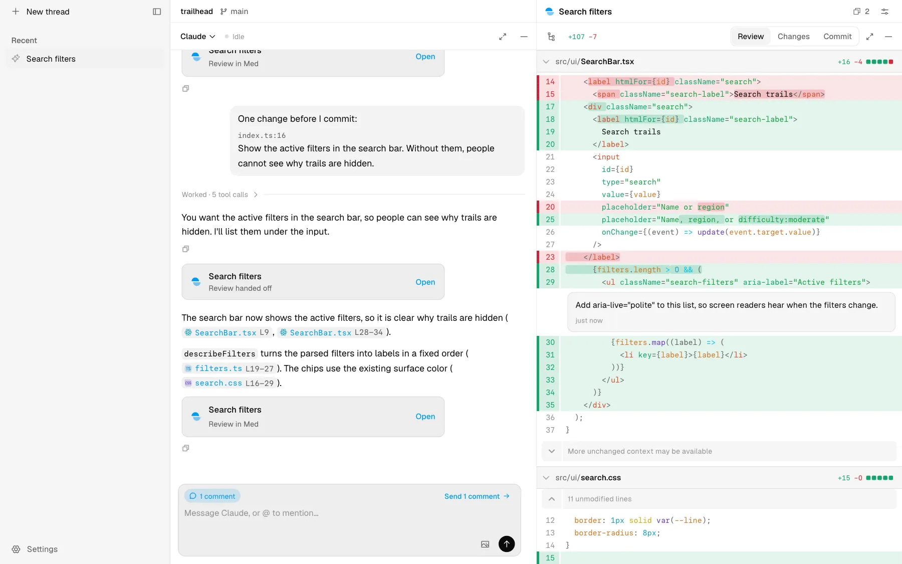
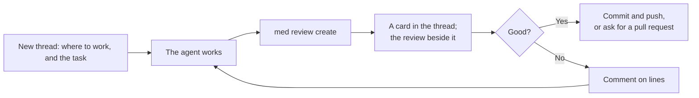
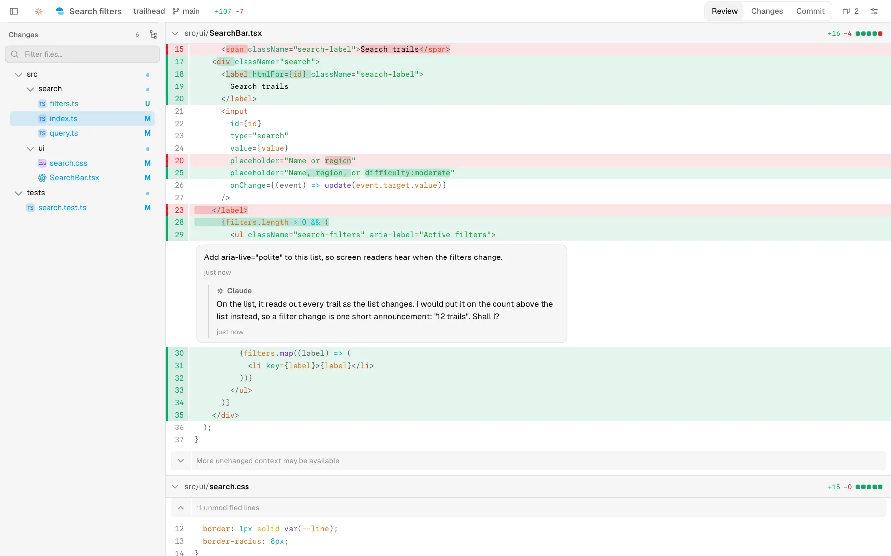
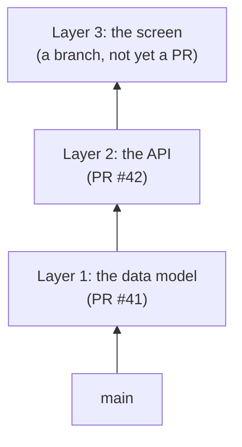
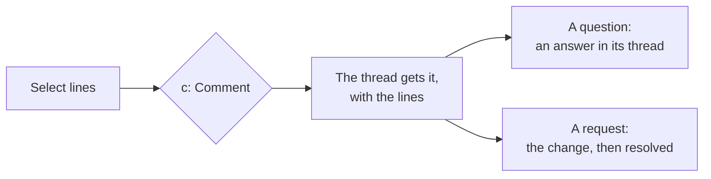
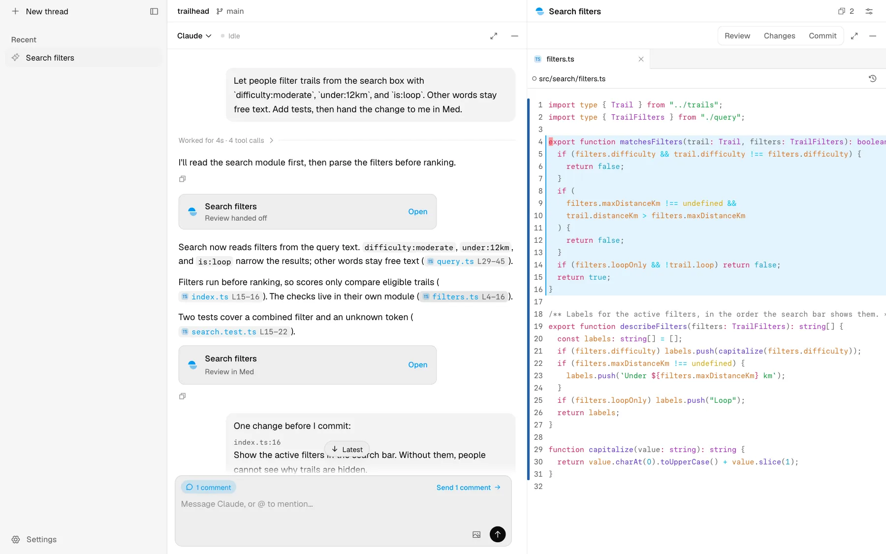
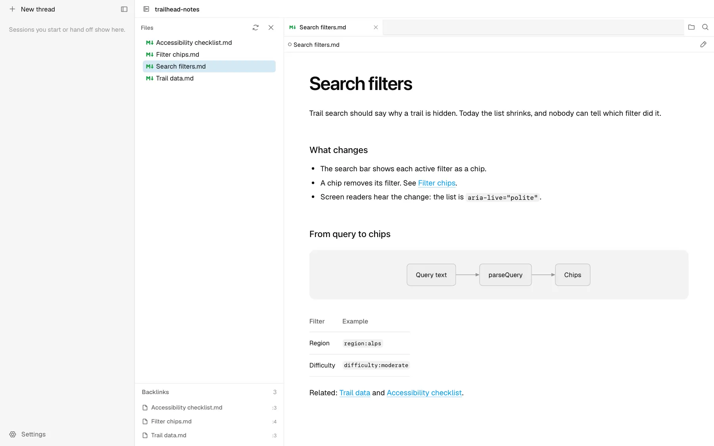
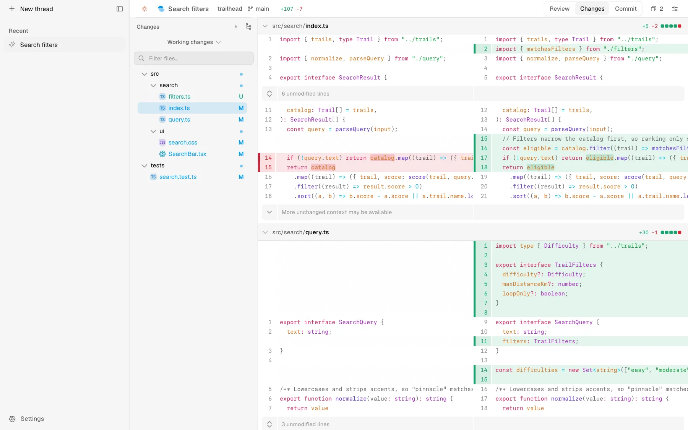
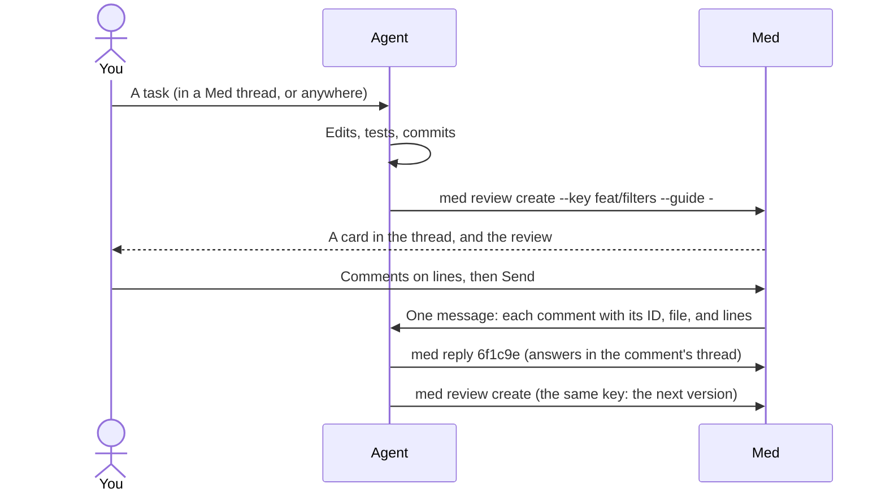

# Med's user flows

The everyday paths through Med, each in a few steps. [Using Med](USAGE.md)
defines the words (thread, session, hand-off, review), and the pages under
`usage/` have the details.

- [An agent changes code, and you review it](#an-agent-changes-code-and-you-review-it)
- [Ask the agent for changes](#ask-the-agent-for-changes)
- [One long thread, with stacked pull requests](#one-long-thread-with-stacked-pull-requests)
- [Ask about the code](#ask-about-the-code)
- [Review a pull request](#review-a-pull-request)
- [Look up a file or a note](#look-up-a-file-or-a-note)
- [Browse a repository](#browse-a-repository)
- [How agents use Med](#how-agents-use-med)

## An agent changes code, and you review it

1. **New thread** (`⌥N`, or `⌘N` in the installed app) puts the task box in
   the middle of the page. Under it, choose the repository and where to work:
   a new worktree (the default) or its checkout. Write the task, and Med
   starts the agent there. An agent that runs in a terminal or the Claude app gets its
   own thread when it hands off.
2. The agent works, then runs `med review create`. The hand-off is a card in
   the conversation, and the review opens beside the session.
3. Read it: **Review** has the agent's guide when it wrote one, **Changes**
   the diff, **Commit** what is left to stage, commit, and push (`1`–`3`).
   The header's **+/−** splits the totals by kind of file on hover.

## Ask the agent for changes

1. In Review or Changes, drag the gutter's **+** across lines, or select line
   numbers and press `c`. Write the comment.
2. Comments wait above the message box as one line, **Send N comments**.
   Send them with a message, or alone.
3. The agent answers a comment in its thread with `med reply <id>`, and hands
   off again with the same key. The thread opens on **New since you looked**.

Med sends only to a session that it runs. For a session that another app
runs, **Copy comments** puts them on the clipboard as Markdown to paste there,
or **Continue in Med** forks the session into Med.

## One long thread, with stacked pull requests

A thread is one intent. When a task grows into several pull requests, they
stay one thread: each part is a layer of a stack, bottom first.

1. The agent hands off each part. A hand-off whose base is the top layer's
   head, from the same session, joins the thread as a new layer: the CLI says
   "Added layer 3". **Ungroup** in the row's menu undoes it. An agent can also
   make the stack at once with `med review create --stack 41 42 feat/screen`.
2. The Review's rail lists the layers, with the base branch at the bottom.
   **This layer** shows one layer's own diff; **Whole stack** shows them
   together; shift-click picks a range. `⌥↑` and `⌥↓` move between layers.
3. Comments belong to the layer that you wrote them on. The agent fixes a
   layer and hands off again; only that layer changes.
4. When a layer is ready, ask for its pull request. The agent writes a draft
   with `med pr draft`, you comment on the draft in Med, and **Create** opens
   it on GitHub. The band then shows the pull request's title and state.

[Stacks and sets](STACKS.md) has the model.

## Ask about the code

- **In the thread.** Type the question in the message box. The agent answers
  in the conversation, and its file references are links with the file's
  icon.
- **On lines.** Select line numbers in Review, Changes, or a guide segment,
  press `c`, and write the question as a comment (`gc` in a file). The agent
  answers in the comment's thread and changes nothing for a question; a
  request, it carries out.

## Review a pull request

1. Paste the pull request's link into **New workspace…** (`⌘K`). Choose
   **Open pull request #333**, or **Open and review with** an agent. From a
   terminal: `med pr checkout 333`.
2. Med makes a worktree for it in its state folder, so your checkout does not
   change, and saves a review from the merge base to the head.
3. The **Pull request** page shows it as GitHub has it: state, checks with
   failures first, reviewers, and the conversation. Code threads show on
   their lines. What you write goes into your pending review on GitHub, which
   nobody sees until you submit it there.
4. A new push adds a version. When you are done, right-click the workspace
   and choose **Close and remove worktree**.

[Pull requests](usage/pull-requests.md) has the details.

## Look up a file or a note

- `⌘⇧K` finds a file by name, `⌘⇧F` searches file contents, and `⌘⇧O` lists
  the symbols of the file on screen. A file the agent names opens from its
  link.
- Each file opens in a tab of its own, with its language icon, and stays
  until you close it. The gutter marks lines that changed; `⌥B` shows blame.
- Right-click a file in a tree or a tab for **Open on GitHub**, **Open in
  Sourcegraph** (set its address in Settings › Open in), **Reveal in Finder**,
  and the paths.
- A vault of Markdown notes opens on its files, with backlinks and wiki
  links; a note reads rendered, and **Edit source** (`⌘⇧V`) opens it to
  edit.

| A file that the agent named                                   | A note in a vault                                          |
| ------------------------------------------------------------- | ---------------------------------------------------------- |
|  |  |

## Browse a repository

1. **Open a repository** (`⌘O`) ranks your repositories by how often and how
   recently you opened them. `↵` opens the repository's own checkout; `Tab`
   searches its branches and worktrees first.
2. It opens on **Changes**: what the checkout's branch changed. The menu at
   the top of the files picks branch, working, staged, or unstaged changes;
   **Base branch…** picks the base, and **Compare revisions…** in **⋯** picks
   a range of commits.
3. **Show files sidebar** in `⌘K` walks the whole tree; any file opens in a
   tab, as above.
4. In a review whose range has two or more commits, the rail's **All files**
   lists them; each opens alone, with its message, and **Whole range** goes
   back.

## How agents use Med

An agent learns Med from its skill (`med skills install`, then `med skills
update` after each release) and from `med docs agents`.

- **One review per task.** The same `--key`, usually the branch, adds a
  version to the same thread. The agent picks the comparison: `--working`,
  `--base <commit> --head HEAD`, `--base main --head HEAD --merge-base`, or
  `--stack` / `--set` for several pull requests.
- **A guide when the change has parts.** The guide is JSON: a summary, then
  segments of files, each with why, and comments where they save time. A
  small change is just the diff.
- **The link ends the turn.** `med review create` prints a link; in the
  thread it shows as the review's card.
- **Comments come back as the next turn.** In a thread that Med runs, they
  arrive as a message; the agent answers each with `med reply <id>` and hands
  off again.
- **Pull requests through Med.** Asked for a pull request, the agent writes it
  with `med pr template` and `med pr draft`, never `gh pr create`; you open it
  with **Create**.
- **Threads.** `med thread list | open | close`, and `find` / `adopt` to bring
  an earlier session into Med.
