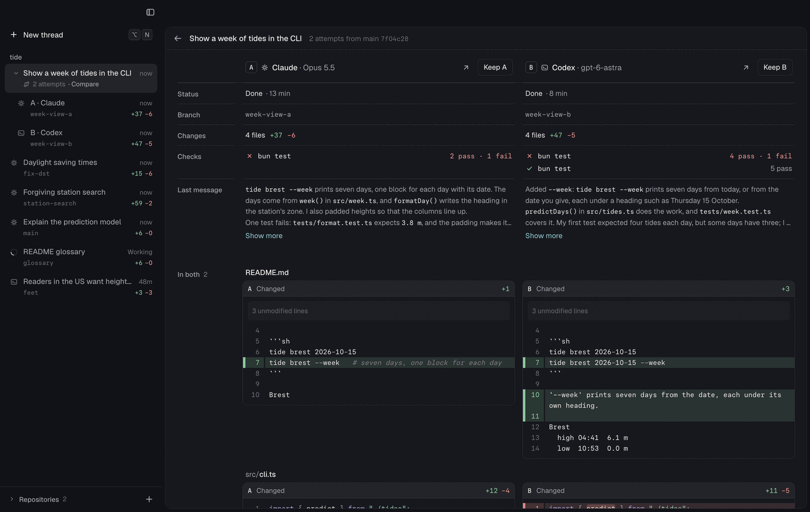
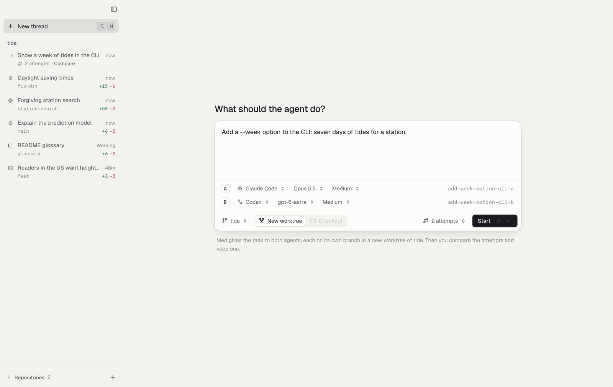
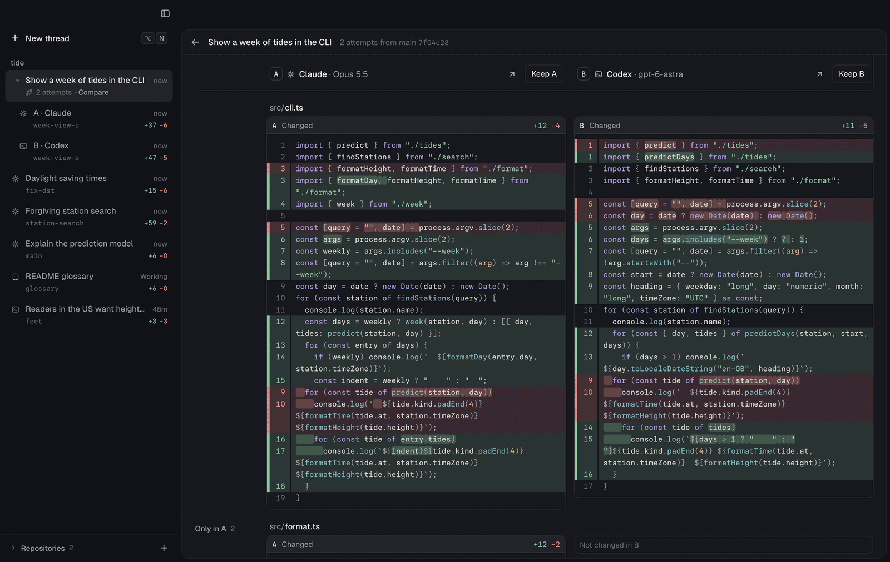

# Attempts: ask twice, keep the best

Experiment 7. Scene: `scripts/explorations/scenes/07-attempts.mjs`.



## The problem

Agents do not give the same result twice. Two agents, or one agent with two
models, often take different paths: one adds a module, the other extends an
existing function; one breaks a test, the other fixes its own. For a task that
matters, the better result is often worth a second try.

Today you can do this in Med only by hand: start two threads, name two
branches, remember which ones go together, open each diff in turn, and then
archive the loser and remove its worktree. Nothing puts the two attempts side
by side, and nothing tells you which one ran its tests.

## The design

**New thread, with attempts.** New thread has one more choice in its controls:
**1 attempt**, **2 attempts**, or **3 attempts**. With two or three, a line
for each attempt shows its letter, agent, model, and effort (the same pickers
as for one agent), and the branch that Med will create. B and C start with an
agent that A does not use, so different agents try the task by default. Each
attempt needs its own worktree, so **Checkout** is off. **Start** starts one
thread for each attempt with the same task, each on its own branch
(`<task>-a`, `<task>-b`, …) in a new worktree, and opens the Attempts page.



**One row in the sidebar.** The sidebar shows the task as one row: its title,
its state ("Working" or "Needs you" when an attempt does), and "2 attempts ·
Compare". The attempts are under it, named by letter and agent, such as
**A · Claude** and **B · Codex**, with their branches and change counts. They
fold when all attempts are done and none is open; the chevron, `→`, and `←`
show or hide them. Click the row to open the Attempts page.

**The Attempts page.** It covers the workspace, as the Search page does. It
has a column for each attempt:

- the agent and model, with **Open** (the attempt's thread) and **Keep**;
- **Status**: Working (with its time so far), Needs you, or Done with the
  time it took;
- **Branch** and **Changes** (files, +, −);
- **Checks**: the test, type-check, lint, and build commands that its
  session ran, with ✓ or ✕ and their counts, such as "4 pass · 1 fail";
- **Last message**: the agent's last reply, four lines until **Show more**.

Below, the changed files. Files that more attempts changed come first ("In
both"), then the files that only one changed ("Only in A"). A file has one
cell for each attempt: its diff against the commit that the attempts started
from, or "Not changed in B". The names and **Keep** buttons stay at the top
while the files scroll. `←` and `→` move between the **Keep** buttons; `Esc`
goes back. In a narrow window, each value names itself instead of a label
column.



**Keep.** **Keep B** makes B the thread. For each other attempt, Med stops its
agent if Med runs it, commits its work to its own branch ("Attempt A of …, not
kept", without hooks or signing), removes its worktree without force, and
archives its thread. A notice says what happened and offers **Undo**. Undo
adds each worktree back from its branch and undoes the save commit, so the
work is uncommitted again, as it was, and brings the threads back.

Med does not remove a worktree that another thread uses, or one where an
agent that Med does not run still works. Then it archives the thread, keeps the
worktree, and the notice says why.

**Handoff from the CLI.** An agent outside Med can mark its review as one
attempt: `med review create --working --group week-view --attempt 2`.

### Why this design

- **One task, one row.** The attempts are separate threads, with their own
  sessions, worktrees, and reviews, so everything that works for a thread
  works for an attempt: the session, comments, archive. The group is
  only a field on each saved review (`group: { id, attempt }`), and the
  sidebar and the Attempts page read it. Nothing else changes shape.
- **Compare what differs.** Two diffs one after the other are hard to
  compare. Side by side, against the same base, the reader sees at once where
  the attempts agree (the same files) and where they took different paths.
  The files in both come first because they show the different decisions.
- **Facts from the sessions, not opinions.** The checks come from the tool
  calls in each transcript, so the page says which attempt ran its tests and
  what the result was, without running anything. The last message is the
  agent's own summary. Med does not score or rank the attempts.
- **Keep is safe and quick to undo.** Keep commits the loser's work to its
  branch before Med removes the worktree, so `git worktree remove` needs no
  force and nothing is lost even after Undo expires. Undo puts it back as it
  was.
- **Restraint.** The page uses the review's type, a quiet letter box for each
  attempt, and the diff colors only. The focused attempt's **Keep** becomes
  the primary button, which is the only accent.

## What changed

| File                                                    | Change                                                                                                                                                                                                                                                        |
| ------------------------------------------------------- | ------------------------------------------------------------------------------------------------------------------------------------------------------------------------------------------------------------------------------------------------------------- |
| `src/shared/attempts.ts`                                | New: the group reference, the compare, Keep, and Undo schemas and routes; `attemptLetter`, `modelName`.                                                                                                                                                       |
| `src/shared/saved-review.ts`, `src/shared/threads.ts`   | An optional `group` on saved reviews, threads, and the thread start.                                                                                                                                                                                          |
| `src/host/attempts.ts`                                  | New: `AttemptGroups`: the compare (diffs against the common base, untracked files, session facts and checks), Keep, and Undo.                                                                                                                                 |
| `src/host/server.ts`                                    | Hook-ins: constructs `AttemptGroups`, adds its routes, names an attempt's branch with its letter, carries `group` to the review and the thread list.                                                                                                          |
| `src/host/saved-reviews.ts`                             | Keeps `group`.                                                                                                                                                                                                                                                |
| `src/cli/review.ts`                                     | `--group` and `--attempt` on `med review create`.                                                                                                                                                                                                             |
| `src/web/data/attempts.ts`                              | New: the page's address, the sidebar's groups, starting attempts, compare, Keep, and Undo.                                                                                                                                                                    |
| `src/web/components/attempts/AttemptsPage.tsx`          | New: the Attempts page.                                                                                                                                                                                                                                       |
| `src/web/components/attempts/AttemptsHost.tsx`          | New: shows the page for its address, and the notice with **Undo**.                                                                                                                                                                                            |
| `src/web/components/attempts/AttemptGroupRow.tsx`       | New: the sidebar's group row.                                                                                                                                                                                                                                 |
| `src/web/components/attempts/NewAttempts.tsx`           | New: the count, the line for each attempt, and the hint in New thread.                                                                                                                                                                                        |
| `src/web/components/shell/NewThread.tsx`                | Hook-ins: the count, the attempt lines, Checkout off, and the start of several attempts.                                                                                                                                                                      |
| `src/web/components/shell/ThreadSidebar.tsx`            | Hook-ins: group rows, an attempt's name in its row.                                                                                                                                                                                                           |
| `src/web/components/Workspaces.tsx`                     | Mounts `AttemptsHost`; the workspaces are inert under the page.                                                                                                                                                                                               |
| `src/web/data/threads.ts`, `src/web/data/workspaces.ts` | A group's attempts stay together; `/attempts/…` is an overlay address.                                                                                                                                                                                        |
| `src/web/data/shortcut-guide.ts`                        | `←` / `→` on the Attempts page and on a group row.                                                                                                                                                                                                            |
| `tests/host/attempts.test.ts`                           | New: start, compare, Keep, and Undo on temporary repositories with the fake agents.                                                                                                                                                                           |
| `tests/browser/attempts.test.tsx`                       | New: the page, Keep with Undo, the kept state, a missing group, and New thread with two attempts.                                                                                                                                                             |
| `docs/USAGE.md`, `ARCHITECTURE.md`                      | How to use attempts, and how the host does it.                                                                                                                                                                                                                |
| `scripts/explorations/world.mjs`                        | Additions: two attempts at "Show a week of tides in the CLI" (Claude with Opus, Codex with `gpt-6-astra`), a fake `claude` and `codex-acp` first on `PATH`, Codex's offered models, and the two reviews as one group. Claude's Bash steps take `error: true`. |
| `scripts/explorations/scenes/07-attempts.mjs`           | New: the scene.                                                                                                                                                                                                                                               |

## How to try it

From `apps/med`:

```sh
bun run build
node scripts/explorations/run.mjs --only 00,07 --port 6491 --out /tmp/attempts-xp
```

The scene sets two attempts in New thread without starting them, opens the
group, compares the two attempts, keeps B, and ends on the sidebar, where B
is an ordinary thread.

The demo world's attempts are real code. In `week-view-a`, `bun test` gives 2
pass and 1 fail: Claude padded `formatHeight` and broke a test, and its last
message says so. In `week-view-b`, `bun test` gives 5 pass: Codex's first test
expected four tides each day, failed on 17 October, and Codex fixed the test.
Both `tide Brest 2026-10-15 --week` commands print a week.

The world puts a fake `claude` (it answers only `initialize`, with its models)
and a fake `codex-acp` first on `PATH`, so New thread never starts a real
agent.

## What I checked

- `bun run build` (type check and both builds), `bun run lint`, and `oxfmt` on
  the changed files: pass.
- `bunx vitest run --project integration tests/host/attempts.test.ts`: 2 pass
  (about 2.4 s). They cover attempts that a start creates (branches `-a` and
  `-b`, refused without a worktree), the compare (agent, model, counts,
  checks from a failed and a passed `bun test`, last message, file order),
  Keep (the save commit, the removed worktree, the archive, the thread list),
  Undo (uncommitted and untracked changes back, HEAD back), a second Undo
  (409), a Codex session from the CLI with `--group`, and a worktree that
  another thread uses, which Keep leaves.
- `tests/host/threads.test.ts`, `tests/integration/review-cli.test.ts`,
  `tests/host/agent-inbox.test.ts`: 22 pass.
- `bunx vitest run --project browser tests/browser/attempts.test.tsx`: 5 pass.
  `tests/browser/workspaces.test.tsx`: 11 pass (one run under load had a
  timeout in "a thread with its session on screen …", which passed alone and
  in the next full run).
- The scene: `run.mjs --only 00,07` passes (07 in
  about 55 s, with its 4 s title card), and `--only 07 --light` passes. No page
  errors.
- Screenshots of New thread (two and three attempts), the sidebar, the page,
  the files, the notice, the kept state, and Undo: dark and light at 1440 px,
  dark at 900 px, and light at 1100 px. At 900 px the page uses its narrow
  layout. That screenshot found a bug: the row labels left the grid, so the
  values moved one column; it is fixed.
- Timing in the demo world, 7 runs, from the click until the result shows:

  | Action                                      | Median | Range      |
  | ------------------------------------------- | ------ | ---------- |
  | Open the Attempts page (compare and render) | 137 ms | 133–146 ms |
  | Keep B (save, remove, archive)              | 232 ms | 227–245 ms |
  | Undo                                        | 229 ms | 225–453 ms |

## Open questions

1. **Undo lasts until the host restarts.** The record is in host memory. The
   work is safe after that: it is a commit on the attempt's branch. Should the archived thread offer to bring an attempt back?
2. **Checks that Med does not know.** Med finds checks by program name (`bun
test`, `vitest`, `tsc`, `cargo test`, and others). A project's own script,
   such as `./check.sh`, does not show. Keep a check command for the
   repository, and offer "Run checks in each attempt"?
3. **Take the best of both.** Keep chooses one attempt. Often B is better but
   A has one good file. A "Use A's version" action on a file would copy it
   into the kept worktree.
4. **Cost.** The columns do not show tokens or cost. The transcripts have the
   usage; it would help to choose a model for the next time.
5. **Three attempts in a narrow window.** Three diff columns at 900 px are
   narrow. Tabs for the attempts under about 1000 px may read better.
6. **Start is one attempt after the other.** Each start makes a worktree and
   starts an agent, so three attempts take a few seconds. When a later attempt
   does not start, the others stay and the page says which one failed.
7. **Names.** The kept thread keeps its `-b` branch. Renaming the branch on
   Keep is possible.
8. **The experiments table.** `docs/explorations/README.md` lists experiment 7
   as "Instant start". I did not change that shared file; the table needs a
   row for Attempts.

## Recommendation

Keep it. It makes a common practice (run the task twice, keep the better
result) one choice in New thread and one click on the Attempts page, and the
comparison shows what the reader would otherwise have to collect from two
threads. It adds no new kind of object: an attempt is a thread with a group.
Most code is in new files (`src/host/attempts.ts`, `src/web/components/attempts/`);
the shared files get hook-ins. Before release, decide on open questions 1 and 2,
and try it with real agents on a larger repository.
