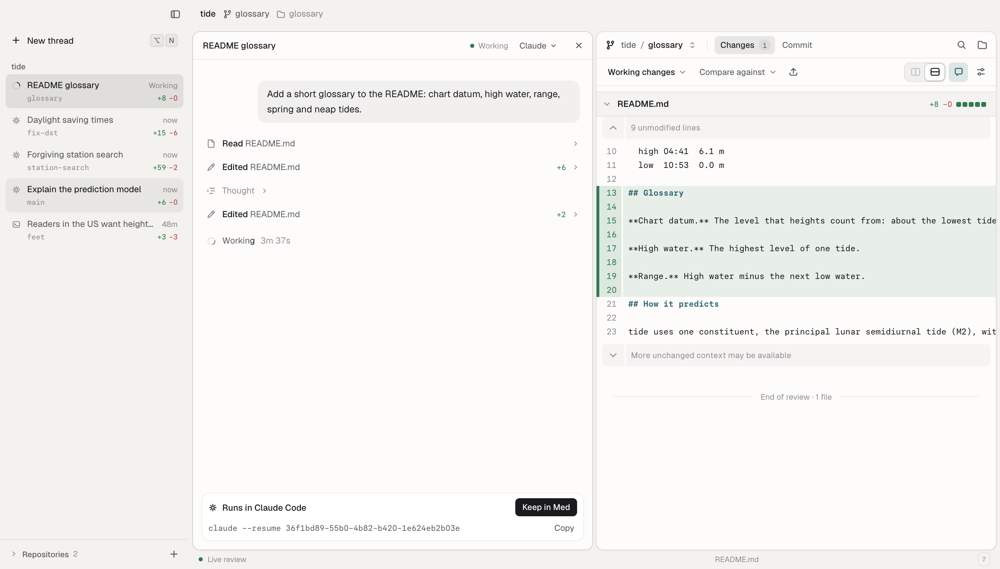
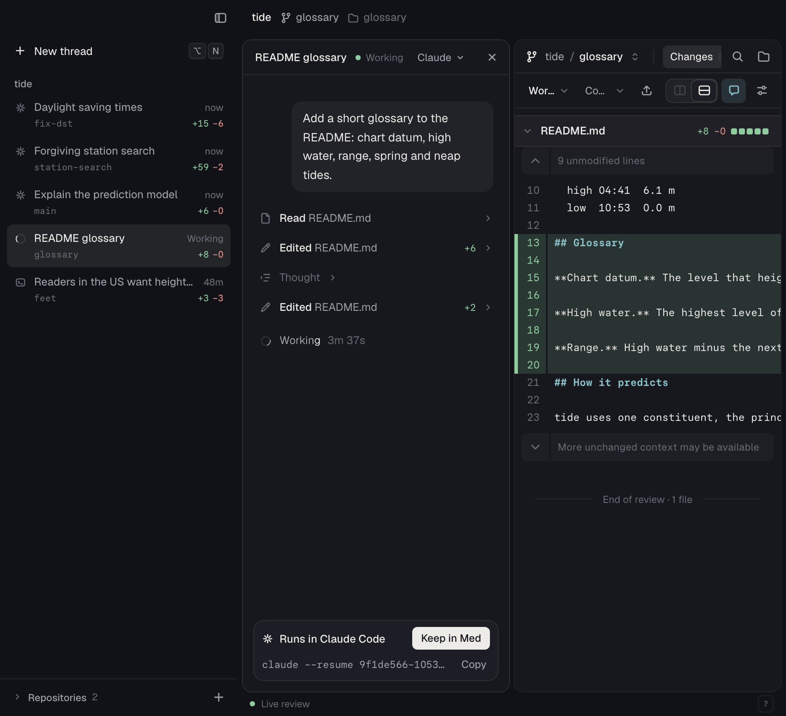

# Every agent, wherever it runs

Experiment 1 of the Med design explorations. Scene:
`scripts/explorations/scenes/01-every-agent.mjs`.



## Problem

Med shows a thread only when an agent runs `med review create`, or when you
start a thread in Med. Much agent work starts in a terminal: Claude Code or
Codex in the same repositories. Med does not show that work until the agent
hands it off. You must remember which session runs where, and you cannot see
the diff of a session while it runs.

## What it does

- The host finds Claude Code and Codex sessions from their transcripts. It
  lists a session when its transcript changed in the last 7 days and its
  directory is a registered repository, one of its worktrees, or a folder in
  one of them.
- Each session shows as a thread among its repository's threads, by time. The
  row has the agent's mark, the branch, the state (Working or idle), and the
  change counts of the checkout. The thread has `found: true` and the ID
  `found-<agent>-<sessionId>`.
- The title is Claude Code's custom title or agent name, or Codex's thread
  name. Else it is the summary, else the first sentence of the first prompt.
- A session that a saved review names (also an archived one) shows only in
  that thread. There are no duplicates.
- Open a found thread: the workspace opens on its checkout. The session pane
  is on the left and follows the transcript. The live working changes are on
  the right.
- In place of the message box, the pane says where the session runs. It gives
  the resume command with Copy (`cd '<dir>' && claude --resume <id>`), and
  **Keep in Med**. Keep in Med saves the checkout's working changes with the
  session linked, as `med review create --working` does. The saved thread
  then takes the place of the found one.
- Quiet controls: **Hide** in a found row's menu (with Undo), and the palette
  command "Hide sessions not kept in Med" (or "Show …"). Med keeps these
  choices in `<state dir>/found-sessions.json`.



## Design, and why

- **The thread list, not a new page.** The sidebar is the one place for agent
  work. A found session is a thread that no agent handed off, so it uses the
  same row. Only the agent mark and the menu (Hide, not Archive) differ.
- **Read transcripts; change no agent.** The agents already write their
  transcripts. Med needs no hook, no setup, and no text in your prompts. It
  also finds sessions that started before Med ran.
- **Cheap, and the list never waits.** A scan reads directory listings and
  file sizes. It reads a transcript (the first 64 KB and the last 256 KB) only
  when its time or size changed. The thread list starts a scan when the last
  one is older than 3 s, and sends the last result at once. Med reads at most
  120 transcripts per scan and shows at most 40 found threads. Change counts
  come from `git diff HEAD --numstat` and `git ls-files --others`, per
  checkout, every 30 s, and at most every 4 s while a session in it changes.
- **Reuse the session routes.** A found thread's ID works with the routes of
  a saved review's sessions (`/api/reviews/:id/sessions/:sid/…`). Thus the
  session pane, the transcript readers, and the live stream do not change. The
  host gives a found ID its one session only when that session's directory is
  in a registered checkout, so the route cannot read other transcripts.
- **No new workspace kind.** A found thread opens as a repository workspace
  with a `found` session. Its review is the live working changes view that
  repository workspaces already have.
- **Read-only, with a way out.** Med does not own the agent's process, so it
  cannot send a message to it. A disabled message box would only say "no".
  The bar says where the session runs, how to go on in a terminal, and how to
  make it a Med thread.
- **Hide, not Archive.** A found thread has no saved review to archive, and
  Med did not make its worktree. Thus "Archive and remove worktree" does not
  show.
- **The right checkout.** A session in a worktree that the registry does not
  know yet (for example `.claude/worktrees/x` in the main checkout) does not
  show in the main checkout. Med reads the worktrees again within 10 s, and
  the session then shows on its own checkout. A session in a removed folder
  does not show.

## Files changed

New:

- `src/host/found-sessions.ts`: the scan, the cache, the titles and states,
  the change counts, and the reader's choices.
- `src/shared/found-sessions.ts`: found thread IDs and the settings schemas.
- `src/web/data/found-threads.ts`: the open input, Hide, the palette commands,
  and Keep in Med.
- `src/web/components/session/FoundSession.tsx`: the session pane and its
  "Runs in" bar.
- `tests/host/found-sessions.test.ts`, `tests/browser/found-threads.test.tsx`.
- `scripts/explorations/scenes/01-every-agent.mjs`.

Small hook-in changes:

- `src/host/server.ts`: make the module, add its threads to the list, resolve
  found IDs in the two session routes, `POST /api/found`, close.
- `src/shared/threads.ts`: `found` on a thread and on the thread list.
- `src/web/data/threads.ts`: note the list's `found.shown`.
- `src/web/data/workspaces.ts`: the `found` session on a repository
  workspace; it names the workspace.
- `src/web/App.tsx`: the thread layout and the session pane for a found
  workspace, and the palette commands.
- `src/web/components/Workspaces.tsx`: open and hide a found thread; no
  prefetch of a saved review for it.
- `src/web/components/shell/ThreadSidebar.tsx`: `data-found`, Hide in place of
  Archive, and the current row.
- `src/web/components/session/SessionPanel.tsx`: a `footer` in place of the
  message box.

## How to try it

```sh
cd apps/med
bun run build
node scripts/explorations/run.mjs --only 01 --port 6431 --out /tmp/med-xp
```

The demo world has a Claude Code session that works on the glossary
worktree and an idle Codex session on the feet branch. They show in the
sidebar without a handoff. Add `--record` for a 2x video, or `--light`.

On your own repositories: start a scratch host with its own state directory
and add a repository in which you use Claude Code or Codex. The sessions of
the last 7 days show in the sidebar.

## Checks and measurements

- `bun run typecheck`, `bun run lint`, and `oxfmt --check` on the changed
  files: pass.
- `bunx vitest run --project integration tests/host/found-sessions.test.ts`:
  2 tests pass. A fixture home (`MED_HOME_DIR`) has Claude Code and Codex
  sessions in a repository, a worktree, a folder inside the checkout, a new
  worktree that the registry does not know, a folder outside, an old one, an
  empty one, and one that a saved review names. The test checks the list,
  the titles, the states, the change counts, the session route, Hide, Show,
  the choices after a restart, and Keep in Med.
- `bunx vitest run --project browser tests/browser/found-threads.test.tsx
tests/browser/workspaces.test.tsx`: 13 tests pass. The found-threads test
  checks the row, open on the checkout with the session pane, Copy, Keep in
  Med, Hide, and the palette command.
- `tests/host/threads.test.ts`, `live-streams.test.ts`,
  `owned-sessions.test.ts`, `tests/integration/saved-review-controller.test.ts`
  and the unit project: pass.
- `node scripts/explorations/run.mjs --only 00,01 --port 6431`: both scenes
  pass with no page errors; scene 01 takes 39 s.
- Scan cost on this computer's real transcripts, for the Workbench repository
  with 21 worktrees (14 sessions found): cold scan 49 ms, warm scans 1–4 ms.
  100 calls of `threads()` (the thread list calls it every 1.5 s) take 1 ms
  together.

## Open questions

- **Codex day folders.** Done: one 7-day window by transcript time for both
  agents. Med lists all Codex day folders every 60 s, so an older session that
  runs again shows. Older sessions come in with `med thread find` and
  `med thread adopt` ([found sessions](../SESSIONS.md#found-sessions)).
- **Codex through ACP.** Done: a test reproduced it with a stand-in for
  codex-acp. Med now keeps the agent's own session ID with the session, and the
  rollout with that ID does not show again.
- **Resume splits history.** `claude --resume` on a session that still runs
  in another terminal makes two writers. The bar does not warn about this.
- **Keep in Med takes the whole checkout.** In a shared checkout (two
  sessions in the main checkout), the saved thread captures the working
  changes of both.
- **Git cost.** Each checkout with a found session costs two Git commands
  every 30 s, and the registry reads worktrees every 60 s. This is small for
  some checkouts; it is not measured for 50.
- **Unread dots.** A found thread gets the unread dot when its turn ends, as
  other threads do. This tells you that a terminal session waits for you, but
  many sessions can make the sidebar noisy. The palette command hides all.
- **Demo world state.** Keep in Med in scene 01 saves a thread in the demo
  world. A later scene that runs in the same world sees it.

## Recommendation

Keep. It makes Med show all agent work on a repository with no setup, and
the code stays in four new modules with small hook-ins. Before release: decide
the unread rule for found threads. (The Codex window and the note in
`docs/SESSIONS.md` are done.)
