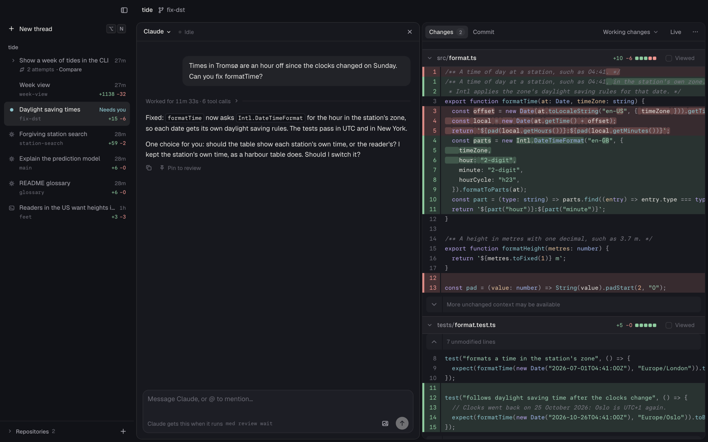
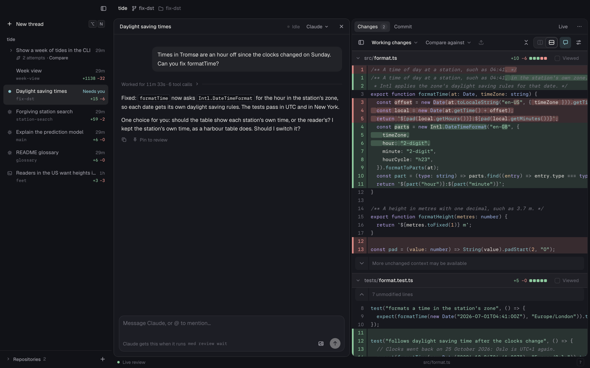
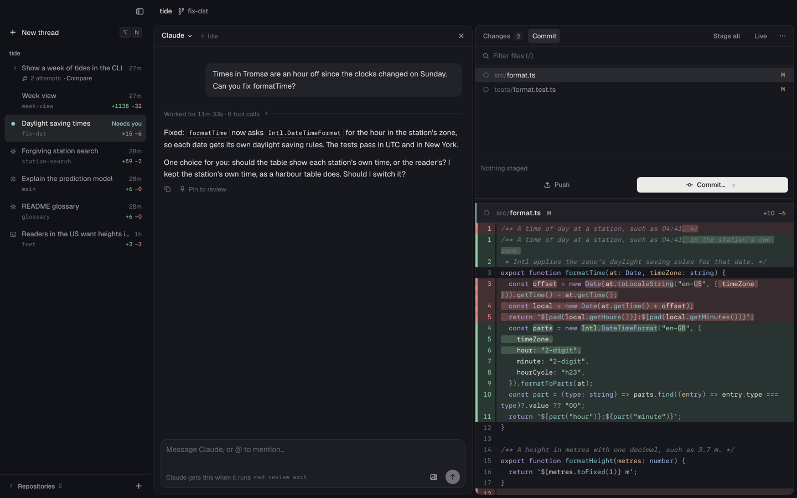
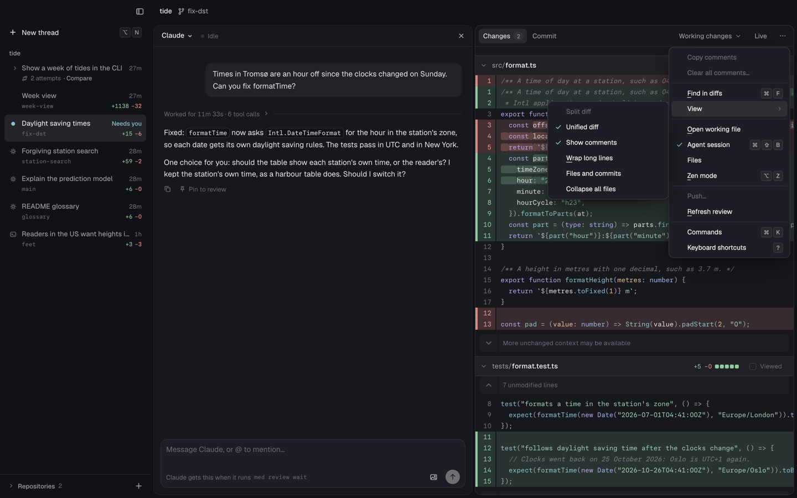
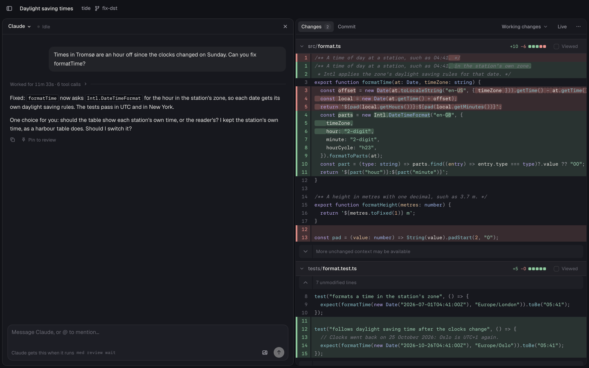
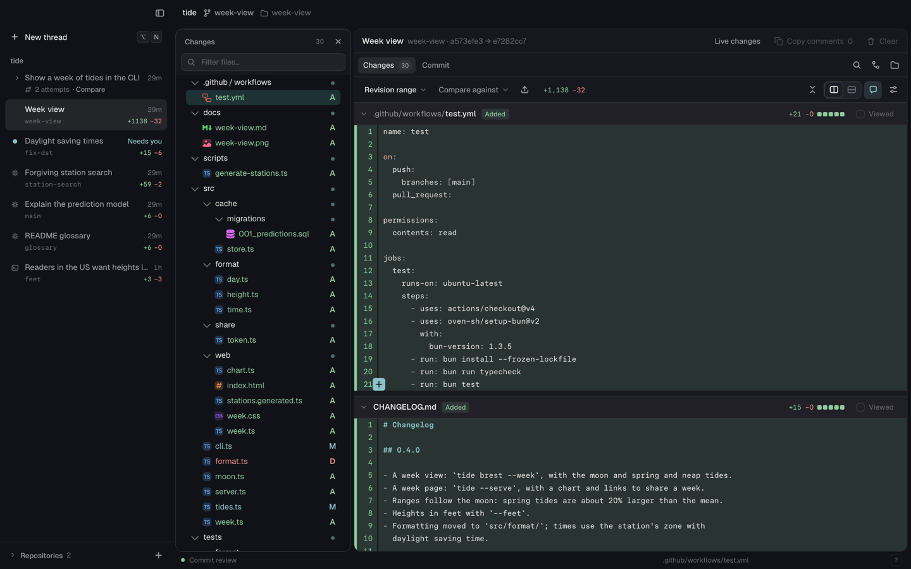
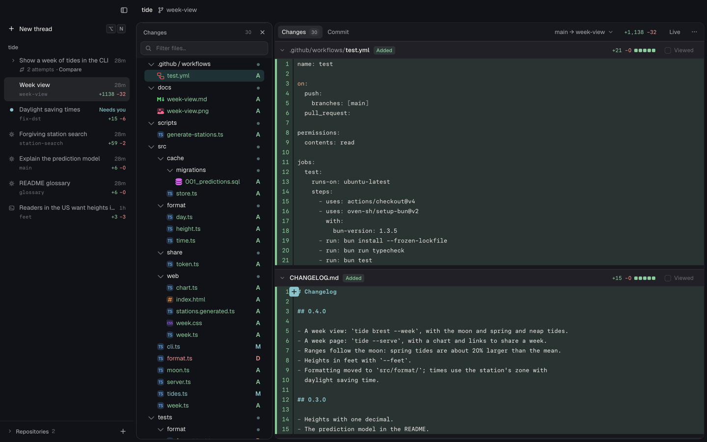
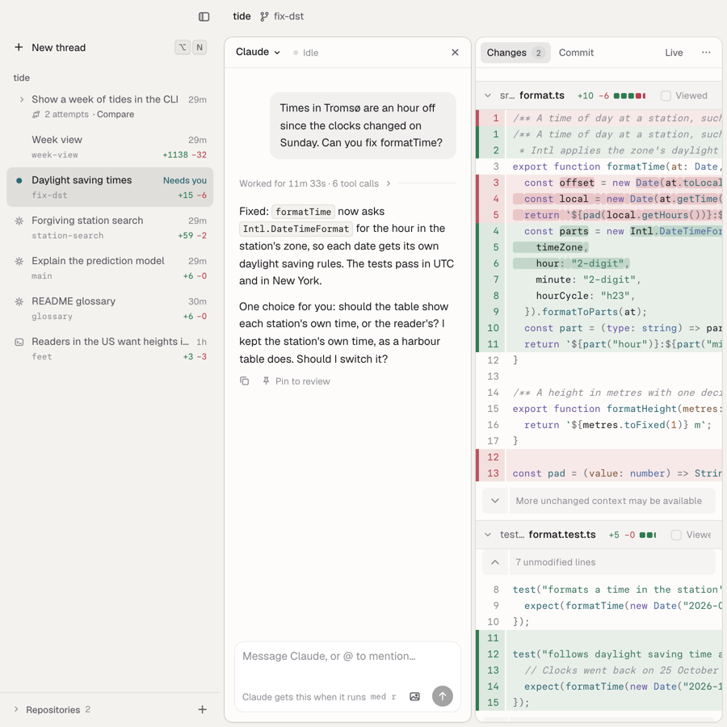

# Quieter chrome: the code starts higher

Experiment 6. Scene: `scripts/explorations/scenes/06-quiet.mjs`.



## The problem

A thread's view stacked rows of chrome above its code: the title band, the
pane headers, the review's tab row, the Changes toolbar, and, under all of
it, the status bar. A saved review without its session had one more row, its
own header. At 1440 × 900, the first diff line was 160 px from the window's
top in a thread with its session, and 198 px in a review without one, with
17 and 20 controls around the code (measured on main).

Many of those rows said the same thing again:

- **The thread's title** was in the sidebar, in the session's header, and in
  the saved review's header.
- **The branch** was in the title band, in the saved review's header
  ("week-view · dc7a5976 → 5953c118"), and, in a repository workspace, in the
  branch switch before the tabs. The title band also showed the worktree's
  folder, which had the branch's name.
- **The range** was in the saved review's header and in the comparison menu,
  which said only "Revision range".
- **The file** was in its own header and again in the status bar.
- **The connection** was a dot that said "Live review" all the time.
- **Copy comments and Clear** were buttons in the review's header and also
  items in its **⋯** menu, as the header changed beside a thread.



## The design

**One setting.** Quiet chrome is on by default on this branch. `⌘K` **Use
full chrome** brings back the layout before; **Use quiet chrome** goes back.
Med keeps the choice in local storage (`med:chrome:v1`), and every window
follows a change at once.

**One row for each pane.** The review pane, the session pane, and the side
panes each have one 38 px row; the title band is 40 px and level with the
sidebar's top row, as before. The session's header was 40 px and the files
pane's 36 px; now each pane header is 38 px in both chromes, so the rows line
up across panes.

**Say each thing once.**

| What                | Where it shows with quiet chrome                                                               |
| ------------------- | ---------------------------------------------------------------------------------------------- |
| The thread's title  | The sidebar. While the sidebar is hidden, the title band.                                      |
| The branch          | The title band, also on the Commit tab. A worktree folder with the branch's name is left out.  |
| What the diff shows | The comparison in the review's row: "Working changes", "main → week-view", "1 commit on main". |
| The agent's state   | The session's row: the agent's menu, then its state.                                           |
| A file's path       | The file's own header; its tooltip also gives the file's size.                                 |
| The Vim mode        | The editor's header: "Vim · NORMAL".                                                           |
| The connection      | Nothing while it is live; "Reconnecting…" at the workspace's lower right.                      |

A saved review keeps the names of its range's endpoints when Med knows them
(`med review create`, Med's threads, attempts): the base and head branches, or
a branch and its count of newest commits. An older record has no names; its
comparison shows short object IDs ("dc7a597 → 5953c11"). A live range whose
head is the branch's tip shows the branch's name.

**Primary actions stay in view; rare ones go to ⋯ and ⌘K.** The review's row
keeps its tabs, the comparison, the totals (when the pane has room), the
comments button (when the review has comments), **Live** or **Return to
review**, **Send to** (when there are comments to send), and **⋯**. On the
Commit tab the row also has **Stage all**, and the tab has no header of its
own. The session's row keeps the agent's menu, its state, and Hide session.



**A narrow pane keeps the tabs and ⋯.** The row measures its other controls.
When the comparison's label does not fit, it takes a short one ("Working",
"Staged", "Unstaged"; a range keeps its names). When the short label does not
fit either, the comparison goes into **⋯** as the menu's first item, a
submenu with the same choices and actions. At 900 px with the session open,
the comparison is in ⋯; at 600 px, it is in ⋯ in all the cases that I tried.



The **⋯** menu has the comments, **Find in diffs**, a **View** submenu with
the diff's options, the panes, **Zen mode**, **Push…**, **Refresh review**,
**Commands**, and **Keyboard shortcuts**. The View submenu keeps the menu
short enough for its popup (420 px) with no scroll. **Push…** is disabled
until Med has read the remotes; its tooltip says why ("Reading the remotes…",
"No commit to push", or the read's error). The comparison menu has two
actions at its end: **Compare against a branch…** (the branch menu opens
below the comparison, or below ⋯ while the comparison is in ⋯) and **Compare
two revisions…**.

**Nothing loses its shortcut.** Every control that left the screen is in
`⌘K` and keeps its key. Three commands are new, for actions that had only a
button: **Compare against a base branch…**, **Push to remote…**, and **Clear
all comments…**.

**One family.** The quiet rows use the same quiet text controls as the
experiments' own: the comparison reads like a tab, as **Claude ⌄** does in the
session's row; **⋯** is the same icon button in every row. Nothing new is
decorated. The only new elements are the band's title (plain text) and the
reconnect notice.



In the installed app on Windows and Linux, the window controls are at the
band's right. The band's end padding is `--med-titlebar-right`, so a long
title truncates before the controls.

### Why this design

- **The code is the content.** Each row removed gives the diff 38 px. A
  thread with its session gains 40 px (25 %); a review without its session
  gains 78 px (39 %). The controls around the code go from 17 to 8, and from
  20 to 8.
- **A repeat costs attention.** Three copies of a title make you check that
  they agree. One place for each thing also gives each thing one meaning: the
  band is "where", the review's row is "what it compares", the session's row
  is "who and how far".
- **A menu, not a toolbar, for rare actions.** Split or unified, wrapping,
  collapsing, pushing, and refreshing are a few times a day; they were 9
  buttons that you saw all day. All are one click away in **⋯** and one search
  away in `⌘K`.
- **One layout, a few changes.** Quiet chrome moves controls and hides rows;
  it does not add a second layout. Full chrome stays as it was, apart from
  the 38 px pane headers, so the choice is cheap to keep or to drop.

## Every control that moved

"Full" is the layout before. A control that the table does not name stays
where it was.

| Control (full chrome)                          | Where it was                             | Quiet chrome                                                                                     | Why                                                   |
| ---------------------------------------------- | ---------------------------------------- | ------------------------------------------------------------------------------------------------ | ----------------------------------------------------- |
| The thread's title                             | Session's header                         | Removed; the sidebar, or the band while the sidebar is hidden                                    | The sidebar's row names the thread                    |
| The thread's title, branch, and range          | Saved review's header (a row of its own) | Removed; the band names the branch, the comparison the range                                     | Said in other places; the row goes                    |
| Worktree folder with the branch's name         | Title band                               | Removed (still in **Copy path**'s name and tooltip)                                              | The same word twice                                   |
| Agent menu (**Claude ⌄**)                      | End of the session's header              | Start of the session's row                                                                       | It names the pane now                                 |
| Branch switch (**Open branch**)                | Before the tabs, in a repository         | Removed; `⌘⇧G`, **⋯ › Open branch or worktree…**, `⌘K`                                           | The band names the branch                             |
| Comparison menu                                | Changes toolbar                          | The review's row, after the tabs; in a narrow row, a short label or **⋯**                        | It says what the diff shows                           |
| **Compare against** (base branch menu)         | Changes toolbar                          | Comparison menu › **Compare against a branch…**; `⌘K`                                            | A second way to choose the comparison                 |
| **Compare revisions…**                         | Toolbar's **View options**               | Comparison menu › **Compare two revisions…**; `⌘K`                                               | The same                                              |
| Totals (+1,138 −32)                            | Changes toolbar                          | The review's row, when the pane has room                                                         | Useful at a glance                                    |
| **Push**                                       | Changes toolbar                          | **⋯ › Push…**, disabled with its reason until Med has read the remotes; `⌘K` **Push to remote…** | Rare                                                  |
| **Show files and commits**                     | Changes toolbar                          | **⋯ › View › Files and commits**; `⌘K`                                                           | The rail shows by itself when there is room           |
| **Collapse all files**                         | Changes toolbar                          | **⋯ › View › Collapse all files**; `⌘K`                                                          | Rare                                                  |
| **Split** and **Unified**                      | Changes toolbar                          | **⋯ › View**; `⌘K` **Use split/unified diff layout**                                             | Set once                                              |
| Comments button (**Toggle notes**)             | Changes toolbar                          | The review's row, only when the review has comments; **⋯ › View**                                | Its count is news only when there are comments        |
| **View options** (gear) menu                   | Changes toolbar                          | Its items are in **⋯** and **⋯ › View**                                                          | One menu, not two                                     |
| **Open command palette**                       | Tab row, without a session               | **⋯ › Commands**; `⌘K`                                                                           | The key is the way                                    |
| **Enter zen mode**                             | Tab row, without a session               | **⋯ › Zen mode**; `⌥Z`                                                                           | Rare                                                  |
| **Toggle agent session**                       | Tab row, without a session               | **⋯ › Agent session**; `⌘⇧B`                                                                     | The session pane has its own Hide                     |
| **Toggle files sidebar**                       | Tab row, without a session               | **⋯ › Files**; `⌘K` **Show files sidebar**                                                       | Rare                                                  |
| **Copy comments**, **Clear**                   | Saved review's header, without a session | **⋯ › Copy comments**, **Clear all comments…**; `⌘K`                                             | They were in ⋯ beside a session already               |
| **Live changes**                               | Saved review's header                    | **Live** in the review's row                                                                     | Kept in view: it changes what the diff shows          |
| Commit tab's header: branch, ↑↓, **Stage all** | Commit tab                               | Removed; **Stage all** in the review's row, ↑↓ on **Push**                                       | The band names the branch                             |
| Status bar: Vim mode                           | Under the workspace                      | The editor's header: "Vim · NORMAL"                                                              | You need it while you edit                            |
| Status bar: a file's size                      | Under the workspace                      | The tooltip of the file's path                                                                   | Rarely needed; one hover away                         |
| Status bar: request timing                     | Under the workspace                      | Removed; full chrome only                                                                        | A diagnostic, not news                                |
| Status bar: connection, path                   | Under the workspace                      | Removed; "Reconnecting…" shows while the page reconnects                                         | Each item is elsewhere, or is news only when it fails |
| Status bar: **?** (shortcuts)                  | Status bar                               | **⋯ › Keyboard shortcuts**; `?`                                                                  | The key is the way                                    |

## Measurements

Measured with `scripts/explorations/measure-chrome.mjs` on the demo world,
dark theme, window height 900 px. "First line" is the top of the first diff
line, from the window's top. "Controls" counts the visible buttons, tabs,
selects, and fields in the title band, the pane header rows, the review's rows
above the diff, and the status bar (not the sidebar, a file's own header, or
the session's thread and message box).

| Case                                            | Width   | Full: first line | Full: controls | Quiet: first line | Quiet: controls |
| ----------------------------------------------- | ------- | ---------------- | -------------- | ----------------- | --------------- |
| Thread with its session (Daylight saving times) | 1440 px | 160 px           | 17             | 120 px            | 8               |
| Thread with its session                         | 900 px  | 160 px           | 17             | 120 px            | 7 (main: 8)     |
| Review without its session (Week view)          | 1440 px | 198 px           | 20             | 120 px            | 8               |
| Review without its session                      | 900 px  | 198 px           | 19             | 120 px            | 7               |

Measured on main (38da08ce) and with the fixes below; the two differ only at
900 px with the session, where the comparison goes into ⋯ (main shows
"Wor…"). The light theme (Med Dawn) gives the same numbers. The first record
had 18 and 22 controls in full chrome, and 9 and 10 in quiet chrome: it also
counted controls that main no longer has, such as the band's **Land…**.







## What changed

| File                                                     | Change                                                                                                                                       |
| -------------------------------------------------------- | -------------------------------------------------------------------------------------------------------------------------------------------- |
| `src/web/data/chrome.ts`                                 | New: the setting (`useQuietChrome`, `setChromeMode`), stored and shared by every window.                                                     |
| `src/web/components/QuietChrome.tsx`                     | New: the ⋯ menu's sections (`useQuietMenu`) and the reconnect notice.                                                                        |
| `src/web/App.tsx`                                        | The toolbar's parts become values that either the toolbar or the review's row shows; the quiet row; `⌘K` commands; no status bar when quiet. |
| `src/web/components/Controls.tsx`                        | `ActionMenu` takes submenus (`MenuEntry`); `ChoiceSelect` takes actions after its choices and a trigger ref.                                 |
| `src/web/components/ComparisonActions.tsx`               | Its base branch menu and Push dialog open without their buttons, from a handle, under an anchor.                                             |
| `src/web/components/SavedReviewHeader.tsx`               | A handle for **Clear all comments…** from `⌘K`; `more` takes submenus.                                                                       |
| `src/web/components/session/SessionPanel.tsx`            | The quiet row: the agent's menu first, then its state; no title. Header 38 px.                                                               |
| `src/web/components/shell/WorkspaceBar.tsx`              | The band names the thread while the sidebar is hidden, and leaves out a worktree folder with the branch's name.                              |
| `src/web/components/FileViewTabs.tsx`                    | `keepTabs`: the comparison gives way before the tabs, and the tabs before the row's last controls.                                           |
| `PaneTree.tsx`, `RepositoryFiles.tsx`, `FileSidebar.tsx` | Pane headers 38 px.                                                                                                                          |
| `tests/browser/workspaces.test.tsx`                      | New test of the setting; the branch picker opens with `⌘⇧G`.                                                                                 |
| `tests/browser/app.test.tsx`                             | Uses full chrome, page-only, and ignores other test files' stored choice.                                                                    |
| `scripts/validate-*.mjs`, `scripts/benchmark-*.mjs`      | `validate-markdown-links` uses the quiet ⋯ menu and `⌘⇧G`; the others store full chrome, as they use the toolbar's buttons.                  |
| `docs/USAGE.md`                                          | A section on quiet chrome.                                                                                                                   |
| `scripts/explorations/`                                  | `chrome-measure.mjs`, `measure-chrome.mjs`, and scene `06-quiet.mjs`.                                                                        |

### Fixes after the first record

| File                                                                          | Change                                                                                                     |
| ----------------------------------------------------------------------------- | ---------------------------------------------------------------------------------------------------------- |
| `src/shared/saved-review.ts`, `src/host/saved-reviews.ts`                     | A saved target keeps `names`: its range's base and head names, or `on` (a branch and a count of commits).  |
| `src/host/repository/history.ts`, `src/host/server.ts`                        | `endpointNames` finds the names when Med captures a range.                                                 |
| `src/web/components/QuietChrome.tsx`                                          | `comparisonLabel` (long and short labels), `useRowFit` (long, short, or ⋯), `fileTitle`; Push… has a hint. |
| `src/web/components/Controls.tsx`, `ToolButton.tsx`                           | A submenu has sections; a menu item's `hint` is its tooltip; `ChoiceSelect` takes a `display` label.       |
| `src/web/components/ComparisonActions.tsx`                                    | `useGitTargets`: the app reads the remotes, so Push… knows when it can open.                               |
| `src/web/components/CommitView.tsx`                                           | `stageIn`: Stage all goes in the review's row, and the view has no header.                                 |
| `src/web/App.tsx`                                                             | The row's comparison slot and Stage all slot; the comparison in ⋯; Push…'s reason.                         |
| `src/web/components/shell/WorkspaceBar.tsx`                                   | The band's end padding is `--med-titlebar-right` plus 4 px, for window controls at the right.              |
| `src/web/components/FileEditor.tsx`, `FullFileView.tsx`                       | "Vim · NORMAL" in the editor's header; the file's size in the path's tooltip.                              |
| `tests/browser/quiet-chrome.test.tsx`, `tests/integration/review-cli.test.ts` | New tests of the names, Stage all, the narrow row, Push…, and the band's inset.                            |

## How to try it

From `apps/med`:

```sh
bun run build
node scripts/explorations/run.mjs --only 00,06 --port 6501 --out /tmp/quiet-xp
node scripts/explorations/measure-chrome.mjs --port 6502 --out /tmp/quiet-measure --shots
```

The scene starts in full chrome, says how many controls there are and where
the code starts, then uses **Use quiet chrome** and shows where each thing
went: the session's row, the comparison menu, **⋯** and its View submenu,
`⌘K`, and the band with the sidebar hidden. It runs for about 45 s after its
card. Its numbers come from the page as it plays, so they can differ from the
table above by the diff's scroll position.

## What I checked

- `bun run typecheck`, `bun run lint`, `bun run build`, and `oxfmt --check` on
  the changed files: pass. (`scripts/validate-review-links.mjs` had format
  issues before this change; I left them.)
- `bunx vitest run --project unit`: 336 pass.
- Every browser test file, three to five at a time: 14 files, 244 tests pass.
  The new test in `workspaces.test.tsx` opens a thread with a session in
  quiet chrome and checks that the session's row and the band do not repeat
  the title, that the comparison is in the review's row, that there is no
  toolbar or status bar, that **⋯** has the moved actions and the View
  submenu, that `⌘K` has **Compare against a base branch…**, and that the band
  names the thread while the sidebar is hidden. Then **Use full chrome**
  brings back the toolbar, the status bar, and the title in the session's
  header, and **Use quiet chrome** removes them again.
- Release validations on the Node build, through a `MED_EXECUTABLE` wrapper
  that runs the host on port 6502: `validate-markdown-links` (quiet chrome),
  `validate-review-links` and `validate-visual-controls` (full chrome),
  `validate-editor-interactions` and `validate-media` (quiet chrome): pass.
  Not run: `validate-service`, `validate-multi-repo`, and
  `validate-navigation-workflows`, which choose their own port; the three
  benchmarks.
- Scenes 00–06 with `run.mjs`: pass, no page errors (06 in 49 s). Scenes 01–05
  run in quiet chrome now; their screenshots show their controls in the
  quiet rows.
- Screenshots in Med Night and Med Dawn at 1440 and 900 px (both chromes),
  at 600 px, in zen mode, on the Commit tab, with the sidebar hidden, with
  the reconnect notice (the live socket closed through a Playwright route),
  and with the installed app's title bar emulated (`data-titlebar="overlay"`
  and its CSS variables).
- The fixes: typecheck, lint, build, and `oxfmt --check` pass. Unit 324,
  integration 216 (6 skipped), and every browser test file, three or four at
  a time: 15 files, 250 tests pass. The release validations that need no
  release artifacts pass. Screenshots in Night and Dawn, in the browser
  window and with window controls at the right, at 1440, 900, and 600 px: a
  review without a session, a thread with a session, the Commit tab, and zen
  mode. Scene 06 runs with no page errors in both themes.

## Open questions and gaps

1. **A repository workspace has no branch button.** The band names the branch
   but its click copies the path. Should the band's branch open the branch
   picker in a repository workspace?
2. **The validations mostly use full chrome.** Four validations and three
   benchmarks store full chrome to keep their checks of the toolbar's
   buttons. If quiet chrome stays, move them to the quiet controls.
3. **Without the window's shell** (only in tests), quiet chrome keeps the
   branch switch and the sidebar toggle before the tabs.
4. **The Commit tab in a narrow pane.** With **Live** and **Stage all** in the
   row, the tabs scroll by 5 px at 900 px with the session open, and by
   19 px at 600 px; the Commit tab's label is cut. ⋯ stays in view. The
   Live toggle goes away when the Changes tab is always live; that frees the
   room.
5. **Older saved reviews have no names.** Their comparison shows short object
   IDs. Med does not add names to old records.

## Recommendation

Keep it, as the default. It gives the code 40–78 px and removes about half of
the controls around it, and each removed control is one click away in **⋯**
and one search away in `⌘K`. Full chrome stays one command away for people
who like the toolbar. Before release, move the validations to quiet chrome.
