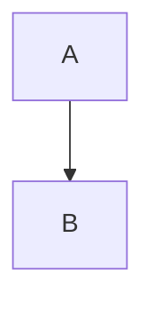

# Release notes

## Release notes

Setext heading
--------------

A paragraph with _emphasis_, **strong**, ~~struck~~, `code`, and a hard  
break. Entities: &copy; &amp; &lt;tag&gt; "quotes" and 'apostrophes'.
Inline <span>raw HTML</span> and a <br> stay out.

- [ ] A task
- [x] A done task
  - Nested item with a [relative link](src/app.ts#L12)
- Item with `inline code`

1. First
2. Second

   A loose paragraph in the second item.

   ```ts
   const nested = true;
   ```

> A quote with a [web link](https://github.com/zsh-eng/workbench/pull/1) and
> a lazy line.
> lazy continuation

| Left                                 |         Center         | Right |
| :----------------------------------- | :--------------------: | ----: |
| a/very/long/path/to/some/file.tsx:12 | `registry.timer(name)` |     3 |
| [link](https://example.com/docs)     |        **bold**        | ~~x~~ |

Autolinks: <https://example.com/a?b=1&c=2>, www.example.org, and person@example.com.
A [mail link](mailto:someone@example.com), an [anchor](#release-notes-1), and a
[footnote ref][^note].


<details>
<summary>More **detail** here</summary>

Hidden text with $$x^2 + y^2$$ math and $HOME text.

- hidden list

</details>

<details open>
<summary>Open fold</summary>

Shown.

</details>

$$
\int_0^1 x\,dx = \frac{1}{2}
$$



```chart
keys: a, b
1, 2
```

```text
plain text block
```

    indented code block

---

[ref]: https://example.com/ref "Ref title"

A [reference link][ref] and [another][missing].

[^note]: The footnote text, with a [link](https://example.com/footnote).

Final paragraph.
