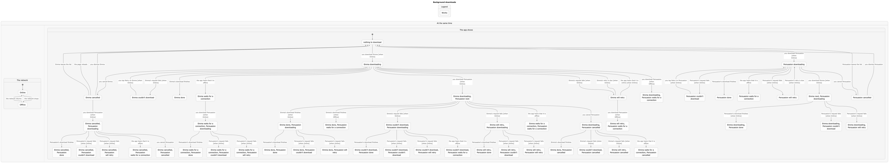
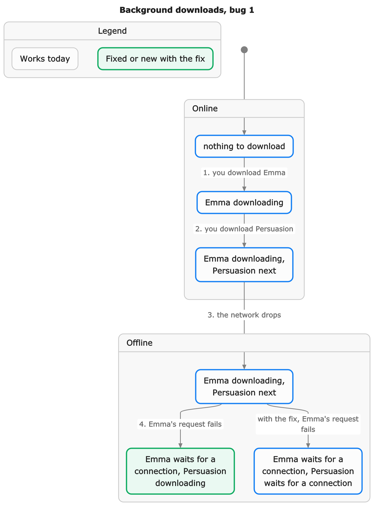

# Background activity: states and checked rules

[MODEL.md](MODEL.md) says what shows. This page is the manager's queue as a
state machine, checked with TLC: [states/Activity.tla](states/Activity.tla)
follows `createActivityManager` in [../src/manager.ts](../src/manager.ts),
and each comment cites the lines it models.

The model has two books, Emma and Persuasion, in one lane that runs one
download at a time, with two attempts each. You can download, cancel, retry
and dismiss either book. The network can drop and come back, with the
browser's online and offline events arriving late. A request can succeed,
fail in a way worth retrying, or fail for good. The retry timer and the
ten-second "leave the list" timer can fire, and the page can reload at any
moment. TLC explores all 10,324 states.

## The rules

| Rule                | In words                                                                                                                                            |
| ------------------- | --------------------------------------------------------------------------------------------------------------------------------------------------- |
| LaneLimit           | No more downloads say Downloading than the lane allows.                                                                                             |
| RunMeansRunning     | A download says Downloading exactly while its request is out.                                                                                       |
| OfflineNothingRuns  | Once the app knows the device is offline, no download says Downloading.                                                                             |
| CancelIsFinal       | A download you cancelled stays cancelled until you start it again: no late answer, retry, reconnect or reload brings it back.                       |
| ReloadKeepsWork     | A reload never loses a download you started and did not cancel. One that gave up comes back as "Couldn't download".                                 |
| OfflineCostsNoRetry | Losing the network never uses up a download's retries.                                                                                              |
| ResumesWhenBack     | Once the network is back and the app has heard, work that waited for it runs again without a tap, and nothing sits in the queue with the lane free. |

All seven hold on the code as it is.

## The chart



The network is one region and what the app shows is the other; they change
independently. A state reads "Emma downloading, Persuasion next". The chart
draws all 52 states the app can show, each with a shortest way in; an arrow
is something you do, the network, a timer, or the app on its own (an event
arriving, a request settling). [states/overview.mmd](states/overview.mmd) is
the same chart as Mermaid.

## Bug 1: the next download started offline



The first version of `pumpOnce()` broke OfflineNothingRuns:

1. You download Emma. Emma downloads.
2. You download Persuasion. It is next.
3. The network drops. The browser has not sent its offline event yet.
4. Emma's request fails. Emma waits for a connection, which frees the lane,
   and Persuasion starts downloading while the app already knows the device
   is offline.

Persuasion's request would fail too, and on a slow failure the app would
show a download that could not happen. Now `pumpOnce()` checks the network
before it starts a job (manager.ts:243-255), so at step 4 both books wait
for a connection. The green state in the chart is the one the fix removes.
The test "the next download does not start once a request has shown the
device is offline" in [../test/manager.test.ts](../test/manager.test.ts)
replays these steps.

## Drawing it again

The charts come from pstack's statechart skill. From `docs/states`:

```sh
node <pstack>/skills/statechart/scripts/statechart.mjs from-spec Activity.tla \
  --cover --png --title "Background downloads"
```

It runs TLC on every rule and writes `Activity-statechart/` (ignored).
Copy `chart.mmd` to `overview.mmd`, and `chart.png` to `overview.png` at 1x
(`sips -Z 5440`). [states/Activity.map.mjs](states/Activity.map.mjs) holds
the words. To draw bug 1 again, put a copy of the spec whose `StartOne`
lacks the offline branch in another folder, and run it there with
`--fixed <this folder>/Activity.tla`.

Change the spec when the manager's states or steps change, and cite the new
lines.

## What the model leaves out

- **Progress and checkpoints.** They change what a row says, not its state.
  The tests cover the 100 ms publishing and the saved checkpoint.
- **Order and lanes.** One lane and one origin, so "your work first" and
  separate lane limits are left to the tests.
- **Starting a job that exists.** start() joins an active job and restarts a
  failed one as retry() does; the model starts only new or finished ones.
- **Tracked jobs.** Sync and the update are shown, not run: the manager
  copies what their source reports.
- **Two tabs.** Each page runs the jobs it restores. Files dedupe one
  download per file within a page, not across tabs.
- **Time.** Backoff and the ten-second linger are steps that may happen at
  any moment, which covers every duration.
- **pause(), resume() and dispose()**, and what the summary shows when
  (the 0.5 s delay, the 1.5 s confirm): see `summary.test.ts`.

## App updates

`createAppUpdate` is a short line, so it has tests
([../test/service-worker.test.ts](../test/service-worker.test.ts)) and no
model:

```mermaid
stateDiagram-v2
  [*] --> idle
  idle --> downloading : a new worker installs
  downloading --> ready : it installed and waits
  downloading --> failed : it became redundant
  failed --> downloading : a check finds it again
  ready --> applying : apply() posts SKIP_WAITING
  applying --> [*] : the worker takes over; the page reloads
  applying --> ready : no switch within 10 s
  ready --> [*] : another tab took over (takenOver); apply() reloads
```



While it downloads, progress counts the new version's precache entries in
Cache Storage against `sw-precache.json`. As a job it is `running` and
quiet while it downloads, `waiting` for a moment once ready (so it shows),
and `running` with the phase "restarting" while it applies. The next page
reads `justUpdated` once, for "Updated".

When to apply is the app's choice. In the Reader, `updateMoment()` in
`apps/reader/src/lib/app-update.ts` is a pure function with table tests:
never on a book; on coming back after two minutes away with no download you
asked for running; at launch; on Restart; and on sync's 410.
