# Sync states

What a local-first client knows about its connection, its account and its
sync, and what it says about them. The code is `src/status.ts` (types, failure
classes, words), `src/controller.ts` (when sync runs, and the store) and
`src/react/index.ts` (hooks). The TLA+ model in `sync-states/` checks the rules
below against that code.

## The problem

Reader, Arctic and Spaced each kept their own sync timer, retry, status words
and sign-in check, and none kept three facts apart: whether the device has a
network, whether the server answers, and whether the server still accepts the
session. Spaced's profile, for example, treats a failed `/me` request as "not
logged in", so opening it offline shows a disabled "Sign in" to someone who is
signed in. `navigator.onLine` alone cannot help:
`false` is reliable, but `true` only means the device has some network.

## Options

1. **Fix each app in place.** Cheapest today, but three schedulers and three
   vocabularies stay, and the next app copies one of them.
2. **A state-machine library per app**, such as XState. Explicit states, but a
   framework and a dependency, and the hard part (what counts as evidence of
   a sign-out) is not something a library decides.
3. **One small store in this package** with three independent axes, a pure
   failure classifier, a pure describer and one scheduler, plus React hooks.
   Apps keep their transport, auth client and UI. **Chosen.**

## Design

### Three axes

| Axis       | Values                                                                                                                            | Changed by                                    |
| ---------- | --------------------------------------------------------------------------------------------------------------------------------- | --------------------------------------------- |
| Connection | `online`, `offline` (the device says so), `unreachable` (online, but the last request got no answer)                              | browser events, and how each attempt ends     |
| Account    | `unknown`, `signed-in` (`confirmed` or from this device's cache), `signed-out`, `expired` (a remembered user whose session ended) | server answers only, and the user signing out |
| Sync       | `running`, `restoring`, `pending`, `lastSyncedAt`, `failure`, `failures`, `retryAt`                                               | the scheduler and each attempt                |

The identity and the last sync time persist per API origin, so "signed in,
offline" survives a restart.

### Rules

- **Only an HTTP answer changes the account.** A 401, or a session check that
  answers "no session", moves a remembered user to `expired` and anyone else to
  `signed-out`. A request that gets no answer never changes the account.
- **Trust `navigator.onLine === false`; treat `true` as a hint.** A request that
  fails without an answer while the device says online makes the connection
  `unreachable`.
- **A late answer about an old cookie is ignored.** A 401 to an attempt that
  began before the credentials changed, or before the server last confirmed a
  session, runs the attempt again instead of ending the session.
- **One attempt at a time, one timer.** While failing, the timer is the retry
  (2 s, doubling to 5 min, jittered to 75–100 %, never earlier than
  Retry-After). Otherwise it is the earlier of the periodic sync and a
  requested sync. Reconnecting runs an attempt now, even during backoff.
  Returning to the page runs one when healthy, at most every 5 s.
- **Sync pauses** while signed out or expired, after a 410 (this app version
  can no longer sync) and after a 409 or scope change (local data belongs to
  another account). Sync now still runs, except offline.

| Failure            | From                                         | Next                        |
| ------------------ | -------------------------------------------- | --------------------------- |
| `network`          | no response, a dropped stream, a timeout     | retry with backoff          |
| `unauthorized`     | 401                                          | wait for a new session      |
| `maintenance`      | 503 with Retry-After                         | retry when the server says  |
| `server`           | other 5xx, 408, 429                          | retry with backoff          |
| `rejected`         | other 4xx, a record the protocol cannot send | retry with backoff, show it |
| `upgrade-required` | 410                                          | stop until reload           |
| `account-changed`  | 409, a changed account or device scope       | stop                        |
| `failed`           | anything else, such as a storage error       | retry with backoff          |

An `AbortError` is a cancellation, not a failure.

### What to show

`describeSyncStatus(status, now)` returns one summary: `kind`, `label`,
`detail`, `attention` (worth showing unasked), `busy` and `action`
(`sign-in`, `retry`, `reload` or none). It picks the first that applies:

1. Offline
2. Update to keep syncing (410)
3. Sync stopped (409 or scope)
4. Sign in again to sync (expired)
5. Restoring… or Syncing…
6. Sign in to sync (signed out)
7. Couldn't reach the server, Sync paused for maintenance, Some changes
   didn't sync, or Sync failed, each with "Retrying in N s"
8. Saved on this device, will sync (pending changes)
9. Synced N min ago, or Not synced yet

A network or server failure raises `attention` only after two failures in a
row, so one dropped request is not an alarm.

## Can the client tell signed out from offline?

Yes, once it has heard from the server. The device remembers the last
confirmed user. Offline, or with a server that does not answer, it keeps
showing that user as signed in ("Offline", or "Couldn't reach the server"),
because no answer said otherwise. Only a 401 or a session check that says
"no session" signs the user out.

It cannot tell in these cases:

- **First launch with no network.** Nobody is remembered, so the account is
  `unknown`. Apps should show a neutral state, not "Sign in".
- **The session ended while the device could not ask** (offline, or between
  attempts). The device shows the remembered user as signed in until the
  next attempt or session check gets a 401. Pending changes stay on the
  device, so nothing is lost.
- **You signed in somewhere this device has not heard from** (another tab, or
  just back from the sign-in redirect). The device says "Sign in again" until
  its next session check or attempt succeeds.
- **A proxy or captive portal that answers 401 itself** looks like an ended
  session.

## Critique, and what changed

- _A single failed request is often a blip._ Attention waits for the second
  failure; the label is still accurate after the first.
- _Better Auth repeats cached session data after a 401._ The controller
  ignores a confirmation that names the refused session id.
- _A 401 for credentials replaced during an attempt._ The auth epoch makes it
  stale, and the attempt runs again.
- _A 401 that arrives after a session check confirmed a newer session._ The
  model found this one: if the device had not yet learned a session id (first
  launch, or the first check failed), the late 401 ended the new session. The
  controller now counts confirmations, and a 401 to an attempt that began
  before the latest one runs it again.
- _Each tab has its own controller._ Tabs share the persisted identity only
  when they load. A sign-in in one tab reaches another through its session
  check (Reader refetches on focus).
- _The simpler alternative_, an `isOnline` and an `isLoggedIn` boolean, cannot
  say "signed in, offline" or "your session ended, your changes are safe", which
  is what users need to see.
- _Cost to apps:_ a `run` function, the session check's answers
  (`confirmSignedIn` / `confirmSignedOut`), and the outbox count
  (`setPending`). That is a few dozen lines per app; the UI reads one summary.

## API

```ts
import {
  createSyncController,
  describeSyncStatus,
  classifySyncFailure,
} from "@zsh-eng/local-sync";
import { useSyncStatus, useSyncSummary } from "@zsh-eng/local-sync/react";

const sync = createSyncController({
  run: async ({ signal, markRestoring }) => client.sync({ signal }), // throw on failure
  intervalMs: 30_000, // 0 turns periodic sync off
  persist: { storage: localStorage, key: "app-sync-status" },
});
sync.start();
sync.setPending(outboxCount);
sync.requestSync(1_000); // after a local change
authAnswer.user
  ? sync.confirmSignedIn({ userId, name, email, image }, sessionId)
  : sync.confirmSignedOut(); // only for an answer, never for a failed request
sync.signOut(); // the user signed out here: forget the identity

const status = useSyncStatus(sync); // SyncStatus
const auth = useSyncStatus(sync, (s) => s.auth); // re-renders only when auth changes
const summary = useSyncSummary(sync); // SyncSummary, ticking for countdowns
```

`SyncStatus` is `{ connection, auth, running, restoring, pending, lastSyncedAt,
failure, failures, retryAt }`. The controller also has `stop`, `syncNow`
(resolves to `synced`, `offline`, `failed` or `cancelled`), `drain`,
`dispose`, `subscribe` and `getSnapshot`. It throws nothing; a failed attempt
is in `status.failure`. `run` can throw this package's `SyncHttpError`,
`SyncNetworkError`, `SyncScopeError` or `SyncRecordError`, or any error with a
numeric HTTP `status`.

## The model

`sync-states/SyncStates.tla` models the controller, `describeSyncStatus` and
the apps' session checks. Each action is one synchronous step of that code,
and each guard cites its line. `SyncStates.map.mjs` labels each state as "the
session: what the app says". Regenerate the chart and stories with pstack's
statechart skill, from a scratch copy of the three files:

```sh
node <pstack>/skills/statechart/scripts/statechart.mjs from-spec SyncStates.tla \
  --expect-broken EndedSessionLooksSignedOut,NewSignInIsSeen --cover --png \
  --title "Sync and sign-in states"
```

| Rule                         | The reader's sentence                                                                                                                                                                          | Result                              |
| ---------------------------- | ---------------------------------------------------------------------------------------------------------------------------------------------------------------------------------------------- | ----------------------------------- |
| `OfflineMeansNoNetwork`      | Offline is shown when the device has no network, and only then.                                                                                                                                | holds                               |
| `NoGuessedSignOut`           | Being offline, or a server that does not answer, never signs you out. Only the server's answer, or you, can.                                                                                   | holds                               |
| `HeardSessionStays`          | While the server accepts a session that this device has heard about, the device never offers Sign in: not offline, not when requests fail, and not after a late answer about an older session. | holds (broken before the fix above) |
| `RetryIsComing`              | "Couldn't reach the server" is shown only while a retry is coming.                                                                                                                             | holds                               |
| `SyncsWhenBack`              | Once the network and the server work again, your changes reach the server without a reload or a tap.                                                                                           | holds (broken before the fix above) |
| `EndedSessionLooksSignedOut` | A session that ended on the server is never shown as signed in.                                                                                                                                | known limit                         |
| `NewSignInIsSeen`            | After you sign in again, here or in another tab, the device never offers Sign in.                                                                                                              | known limit                         |

The two known limits are the "cannot tell" cases above. TLC explored 14,188
states and 88,628 transitions. The overview below keeps the shortest path to
each of its 23 states (24 of 118 arrows). Gray states work; red and orange
ones are the known limits; "Sign in again to sync" after an ended session is
white only because every way there passes a state where the device did not yet
know.

```mermaid
---
title: "Sync and sign-in states"
config:
  markdownAutoWrap: false
  state:
    useMaxWidth: false
---
stateDiagram-v2
  classDef works fill:#f4f6f7,stroke:#566573,color:#1b2631
  classDef wrong fill:#fdedec,stroke:#c0392b,color:#7b241c
  classDef fixed fill:#e9f7ef,stroke:#1e8449,color:#145a32
  classDef mixed fill:#fdebd0,stroke:#d35400,color:#7e5109
  classDef after fill:#ffffff,stroke:#808b96,color:#566573
  classDef worse fill:#f4ecf7,stroke:#7d3c98,color:#4a235a
  classDef worksPath fill:#f4f6f7,stroke:#1f3a93,stroke-width:4px,color:#1b2631
  classDef wrongPath fill:#fdedec,stroke:#1f3a93,stroke-width:4px,color:#7b241c
  classDef fixedPath fill:#e9f7ef,stroke:#1f3a93,stroke-width:4px,color:#145a32
  classDef mixedPath fill:#fdebd0,stroke:#1f3a93,stroke-width:4px,color:#7e5109
  classDef afterPath fill:#ffffff,stroke:#1f3a93,stroke-width:4px,color:#566573
  classDef worsePath fill:#f4ecf7,stroke:#1f3a93,stroke-width:4px,color:#4a235a
  state "Legend" as legend {
    state "Works" as legendWorks
    state "Breaks a rule" as legendWrong
    state "Breaks a rule in some cases" as legendMixed
    state "Reached only after a bug" as legendAfter
  }
  class legendWorks works
  class legendWrong wrong
  class legendMixed mixed
  class legendAfter after
  state "Not signed in" as g0 {
    state "Couldn't reach the server" as s0
    state "Offline" as s1
    state "Sign in to sync" as s2
    state "Syncing" as s3
  }
  state "Session ended" as g1 {
    state "Couldn't reach the server" as s4
    state "Offline" as s5
    state "Saved on this device, will<br/>sync" as s6
    state "Sign in again to sync" as s7
    state "Sign in to sync" as s8
    state "Synced" as s9
    state "Syncing" as s10
  }
  state "Signed in again" as g2 {
    state "Couldn't reach the server" as s11
    state "Offline" as s12
    state "Saved on this device, will<br/>sync" as s13
    state "Sign in again to sync" as s14
    state "Sign in to sync" as s15
    state "Synced" as s16
    state "Syncing" as s17
  }
  state "Signed in" as g3 {
    state "Couldn't reach the server" as s18
    state "Offline" as s19
    state "Saved on this device, will<br/>sync" as s20
    state "Synced" as s21
    state "Syncing" as s22
  }
  [*] --> s3
  s3 --> s1 : the network drops
  s3 --> s17 : you sign in or another tab<br/>signs in
  s3 --> s2 : the server refuses the session<br/>or a refusal of the old<br/>session arrives or the sync<br/>gets no answer
  s3 --> s0 : the sync gets no answer
  s17 --> s12 : the network drops
  s17 --> s10 : the session ends on the server
  s17 --> s16 : the sync finishes
  s17 --> s22 : the session check finds the<br/>session
  s17 --> s15 : the sync gets no answer or the<br/>server refuses the session or<br/>a refusal of the old session<br/>arrives or the sync finishes
  s12 --> s5 : the session ends on the server
  s17 --> s11 : the sync gets no answer
  s10 --> s9 : the sync finishes
  s17 --> s13 : the sync finishes
  s22 --> s19 : the network drops
  s22 --> s10 : the session ends on the server
  s10 --> s8 : the sync gets no answer or the<br/>server refuses the session or<br/>the sync finishes or a refusal<br/>of the old session arrives
  s10 --> s4 : the sync gets no answer
  s10 --> s6 : the sync finishes
  s19 --> s5 : the session ends on the server
  s22 --> s18 : the sync gets no answer
  s10 --> s7 : the session check finds no<br/>session or the server refuses<br/>the session
  s17 --> s21 : the sync finishes
  s17 --> s20 : the sync finishes
  s17 --> s14 : the server refuses the session
  class s0 works
  class s1 works
  class s2 works
  class s3 works
  class s4 mixed
  class s5 mixed
  class s6 mixed
  class s7 after
  class s8 works
  class s9 mixed
  class s10 mixed
  class s11 works
  class s12 mixed
  class s13 works
  class s14 wrong
  class s15 wrong
  class s16 works
  class s17 mixed
  class s18 works
  class s19 works
  class s20 works
  class s21 works
  class s22 works
```



The model leaves out the periodic timer and the 5 s wake gap (they only add
attempts), 409/410/503 failures, a second user, more than one tab's controller,
the time between an outbox write and `setPending`, and a session check that
overlaps another. It starts the controller at launch, as Spaced does; Reader
and Arctic start it once signed in, which only removes attempts while the
account is unknown. A session check is one step: its request and answer happen
together. An edit asks for a sync, as Arctic's `syncSoon` does; in Reader and
Spaced the next periodic attempt plays that part.

## In the apps

- **Reader**: `SyncService.controller` runs `SyncV2Client`. `observeAuthSession`
  passes Better Auth's answers to the controller and ignores its errors other
  than 401. `useAuth` reads the account from the controller, and the account
  menu shows `useSyncSummary`.
- **Arctic**: each session owns a controller over its four channels; the
  account check at open confirms or ends the remembered account.
- **Spaced**: `spacedSync` in `src/lib/sync/engine.ts` runs `/me`, then pull and
  push. `/me`'s answer is its session check. The profile should read
  `useSyncStatus(spacedSync, (s) => s.auth)` and `(s) => s.connection` instead
  of `useLoggedInStatus` and `useOnlineStatus`: `ConnectionNotice` takes
  `connection === "offline" ? "offline" : "online"`; the account button shows
  the remembered user while `signed-in`, "Sign in again" while `expired`,
  "Sign in" while `signed-out`, and a neutral state while `unknown`. Sign-in
  and sign-out need the server, so disable them offline rather than hiding the
  account. The expired banner should follow `auth.status === "expired"`.
